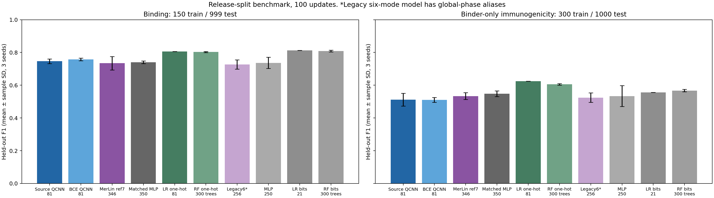
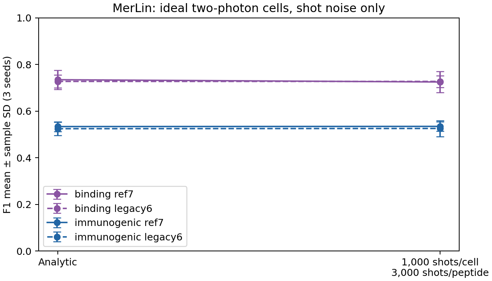

# Q-CHIPP: Quantum Convolutional HLA Immunogenic Peptide Prediction — Reproduction

## Reference and Attribution

- **Paper:** R. Peters et al., *Quantum convolutional HLA immunogenic peptide
  prediction (Q-CHIPP): Next-generation neoantigen prediction with quantum
  neural network*, Science Advances (2026).
  DOI [10.1126/sciadv.aec3824](https://doi.org/10.1126/sciadv.aec3824);
  open access at [PMC13398535](https://pmc.ncbi.nlm.nih.gov/articles/PMC13398535/).
- **Author code:** [IBM/Q-CHIPP v1.0.0](https://github.com/IBM/Q-CHIPP/tree/v1.0.0),
  commit `9f72bd9fc87522bc45c806f9849d07210a64e48d`, Apache-2.0
  (Zenodo 10.5281/zenodo.19186890).
- **Author figure code:** [RyanPeters785/QCHIPP_figures](https://github.com/RyanPeters785/QCHIPP_figures/tree/qchipp_publication),
  commit `4b19620deb7e890bd2a306c4bc518879d6e2b2db`.
- **Licences:** the paper is CC-BY-NC-4.0 and no separate licence is stated for
  the DataS1 supplement, so this repository downloads it rather than
  redistributing it. `lib/gate.py` and `tests/ibm_qchipp_reference.py` translate
  or reproduce Apache-2.0 IBM code and keep its licence header.

## Original Paper

Q-CHIPP predicts whether a mutant peptide is a neoantigen with two
gate-based quantum convolutional neural networks (QCNNs) on HLA-A\*02:01
nine-mers:

1. a **binding** head predicts peptide–MHC binding;
2. an **immunogenicity** head, trained only on experimentally confirmed binders,
   predicts a T-cell response.

A peptide is predicted immunogenic only when both heads are positive. Selected
residues are binary-encoded, compressed into qubits with (2,1) quantum random
access codes (QRAC) or basis encoding, processed by a pyramid QCNN and trained
with SPSA. The paper reports a noiseless-simulator binding F1 of 0.73
(QRAC 2:1, 10 qubits) and a best binder-only immunogenicity F1 of 0.67
(positions 3, 5, 6, 7), runs on IBM hardware with 20 and 46 qubits, and
associates predicted neoantigen burden with patient survival.

[PAPER_ANALYSIS.md](PAPER_ANALYSIS.md) lists the claims, experiments, exact
reported metrics and the conflicts found between the manuscript and the
released code.

## Reproduction Scope (Updates and Deviations)

Reproduced:

- The source gate QCNN (`lib/gate.py`): a PyTorch statevector translation of the
  authors' Qiskit pyramid, checked against the IBM v1.0.0 circuits to 2e-12 at 4,
  8 and 10 qubits (`tests/test_gate.py`), trained with the released SPSA schedule
  and objective.
- Binding and binder-only immunogenicity on the **released DataS1 splits**,
  three seeds (49, 50, 51), 100 full-batch updates, last checkpoint, no
  test-set model selection.
- Fair classical controls on the same inputs: logistic regression and random
  forest on the residue bits and on 80 one-hot columns, and a hierarchical MLP
  with a matched parameter budget.
- A **MerLin photonic adaptation** of the QCNN (`lib/photonic.py`).

Deviations and updates:

- **Splits and test sizes.** The released splits are used as is. The test sets
  have 1000 rows (999 for binding after one exclusion), not the 50/100 described
  in the manuscript, so the numbers are a release-split comparison, not an exact
  table replication.
- **Source objective.** The released estimator applies a scalar cross-entropy
  directly to the signed score 0.5⟨Z⟩, not a Bernoulli BCE
  ([LOSS_SEMANTICS.md](LOSS_SEMANTICS.md)). The source objective is reproduced as
  released (`gate_source`); `gate_corrected` trains the same circuit with a
  corrected BCE. The release-default 0/1 labels, under which negatives contribute
  zero loss, are run as a single-seed sensitivity check.
- **Parameter sharing.** The released pyramid does not share parameters within a
  layer, despite the manuscript's wording. The translation follows the code.
- **Photonic translation is partial.** Each local filter is a two-photon optical
  cell; pooling measures the Fock distribution and re-encodes three classical
  features, so coherent qubit pooling and the full representational scale are
  not preserved. The primary model uses seven modes with an unencoded reference
  mode ([PHOTONIC_DESIGN.md](PHOTONIC_DESIGN.md)). The first six-mode design
  encoded every mode, which makes a common phase shift unobservable: distinct
  residue codes (A and L) gave identical outputs. It is kept as a labelled
  ablation (`merlin`), and `tests/test_reference_encoding.py` guards the fix.
- **Not reproduced:** the 20- and 46-qubit IBM hardware runs, device-noise
  mitigation, the exhaustive position search and the clinical survival analysis
  (controlled-access cohorts, no QPU access).
- **Environment.** CPU only, single-threaded, float32. Results were produced with
  MerLin 0.4.1; the code now requires MerLin 0.4.2, which reproduces the seed-49
  runs bit-for-bit (see Results).

## Project Layout

```text
papers/QCHIPP/
|-- README.md, requirements.txt, cli.json, notebook.ipynb
|-- PAPER_ANALYSIS.md      claims, experiments and source/manuscript conflicts
|-- PHOTONIC_DESIGN.md     MerLin adaptation design
|-- LOSS_SEMANTICS.md      analysis of the released training objective
|-- DATA_PROVENANCE.md     DataS1 hashes, contents and licence notes
|-- configs/               defaults.json plus one config per task x model
|-- lib/
|   |-- runner.py          train_and_evaluate(cfg, run_dir)
|   |-- data.py            DataS1 download, verification, splits, encoding
|   |-- gate.py            source gate QCNN and objectives
|   |-- photonic.py        MerLin photonic QCNN (legacy six-mode and reference)
|   |-- classical.py       matched hierarchical MLP
|   |-- baselines.py       logistic regression and random forest controls
|   |-- affinity.py        supplied affinity-rank diagnostic
|   |-- models.py          model registry shared by training and inference
|   |-- training.py        fixed-budget training and evaluation
|   |-- metrics.py         held-out metrics at a fixed 0.5 threshold
|   |-- artifacts.py       JSON/CSV writers and provenance
|   `-- inference.py       two-head AND predictor from saved checkpoints
|-- utils/
|   |-- run_comparison.py  task x model x seed sweeps
|   `-- render_results.py  curated tables and figures from the sweeps
|-- tests/
|-- models/
`-- results/               curated results (RESULTS.md, figures, summaries)
```

## Install and How to Run

```bash
pip install -r papers/QCHIPP/requirements.txt
```

`requirements.txt` installs MerLin 0.4.2 (and its Perceval dependency), PyTorch,
scikit-learn and matplotlib. Qiskit is needed only by `tests/test_gate.py`.
A CPU-only PyTorch build is sufficient. DataS1 is downloaded on the first run
(see [Data](#data)).

Quick smoke runs, from the repository root:

```bash
# Binding logistic-regression control (default config, a few seconds)
python implementation.py --paper QCHIPP

# One update of the MerLin reference model and of the source gate QCNN
python implementation.py --paper QCHIPP --config configs/binding_merlin_reference.json --epochs 1
python implementation.py --paper QCHIPP --config configs/binding_original.json --epochs 1
```

From inside `papers/QCHIPP/`, use `python ../../implementation.py --config ...`.

Full reproduction of the 62 reported runs (about 12 minutes of compute on one
CPU core):

```bash
python papers/QCHIPP/utils/run_comparison.py --epochs 100 --seeds 49 50 51 \
    --models gate_source gate_corrected merlin classical rf logistic \
    --output papers/QCHIPP/outdir/comparison100
python papers/QCHIPP/utils/run_comparison.py --epochs 1 --seeds 49 50 51 \
    --models logistic_onehot rf_onehot \
    --output papers/QCHIPP/outdir/comparison_onehot
python papers/QCHIPP/utils/run_comparison.py --epochs 100 --seeds 49 50 51 \
    --models merlin_reference classical_reference \
    --output papers/QCHIPP/outdir/comparison_reference
python implementation.py --paper QCHIPP --config configs/binding_source_zeroone.json \
    --outdir outdir/label01_binding
python implementation.py --paper QCHIPP --config configs/immunogenic_source_zeroone.json \
    --outdir outdir/label01_immunogenic
python papers/QCHIPP/utils/render_results.py
```

`--epochs` has no effect on the scikit-learn controls, which are fitted to
convergence. `render_results.py` re-verifies every run against its
`run_status.json` and rewrites `results/RESULTS.md`, `comparison_summary.json`,
`performance.png` and `finite_shots.png`.

Each run writes `outdir/run_YYYYMMDD-HHMMSS/` (relative to `papers/QCHIPP/`)
with `config_snapshot.json`, `run.log`, `run_status.json`, `metrics.json`,
`predictions.csv` and `model.pt` (with `losses.csv`) or `model.pkl`. `outdir/`
is not committed. Load `model.pkl` files only from your own runs.

`lib/inference.py` restores a binding and an immunogenicity run of the same
model family and predicts `positive = binding_positive AND
immunogenic_positive`; the notebook demonstrates it on the seed-49 reference
heads.

## Configuration

`cli.json` is the authoritative CLI schema. Paper-specific flags: `--epochs`,
`--lr`, and the sweep bookkeeping flags `--sweep-id`, `--run-id`,
`--repetition`. Global flags (`--config`, `--seed`, `--outdir`,
`--data-root`, `--dtype`, `--device`, `--log-level`) come from the shared
runtime.

Configs are named `<task>_<model>.json` and overlay `defaults.json`:

| Model key | Config suffix | Description |
|---|---|---|
| `gate_source` | `_original` | Source gate QCNN, released signed-label objective, SPSA |
| `gate_corrected` | `_corrected` | Same circuit, corrected Bernoulli BCE, Adam |
| `merlin_reference` | `_merlin_reference` | Seven-mode MerLin model with reference mode (primary) |
| `merlin` | `_merlin` | Legacy six-mode MerLin model (ablation) |
| `classical_reference` | `_classical_reference` | MLP matched to `merlin_reference` (350 parameters) |
| `classical` | `_classical` | MLP matched to `merlin` (250 parameters) |
| `logistic`, `rf` | `_logistic`, `_rf` | Controls on the 20 residue bits |
| `logistic_onehot`, `rf_onehot` | `_logistic_onehot`, `_rf_onehot` | Controls on 80 one-hot columns |
| `gate_source` with 0/1 labels | `_source_zeroone` | Label-convention sensitivity |

`defaults.json` is the binding logistic-regression control. Important keys:
`dataset.task` (`binding` or `immunogenic`), `dataset.positions` (binding
2, 4, 5, 9; immunogenicity 3, 5, 6, 7), `training.epochs`, `training.lr`,
`training.spsa_a` / `spsa_c` (source gate only), `model.source_labels`
(`signed` or `zero_one`, source gate only), `model.hidden` (MLPs),
`evaluation.shots` (shots per optical cell; 0 is analytic) and `baselines.*`
(scikit-learn hyperparameters). The `*_reference1000.json` configs (1000
updates) were not run for the reported results.

## Data

DataS1 is the supplementary data file of the paper: 8470 unique HLA-A\*02:01
nine-mers with experimental MHC-binding and T-cell assay labels and the
released task splits. `lib/data.py` downloads the Europe PMC supplement bundle
(`https://www.ebi.ac.uk/europepmc/webservices/rest/PMC13398535/supplementaryFiles`)
on first use, extracts `aec3824_data_file_s1.csv` into
`data/QCHIPP/paper_supplement/` and verifies its SHA-256
(`2b91dde1…0bb3b07`) on every load. Use `--data-root` or `DATA_DIR` for another
data location. If the download fails, place the CSV there manually from the
article's supplementary material.

| Task | Train | Test | Labels |
|---|---:|---:|---|
| Binding | 150 (75/75) | 999 | Experimental MHC assay |
| Binder-only immunogenicity | 300 (150/150) | 1000 | Experimental T-cell assay, confirmed binders only |

The binding test peptide DLPLIIQRL has no assay result and is excluded rather
than labelled from predicted affinity. There is no train/test overlap. The
residue encoding follows the source code, which fits the sorted category
vocabulary over train and test together; this transductive step is disclosed.
[DATA_PROVENANCE.md](DATA_PROVENANCE.md) has the full hashes and dataset checks.

## Results Obtained and Comparison with the Paper

Three seeds, 100 full-batch updates for trainable models, released test splits.
Mean ± sample SD measures optimisation variability on one split, not
independent-cohort uncertainty. Full tables: [results/RESULTS.md](results/RESULTS.md).

| Model | Parameters | Binding F1 | Binding AUROC | Immunogenicity F1 | Immunogenicity AUROC |
|---|---:|---:|---:|---:|---:|
| Source gate QCNN | 81 | 0.7466 ± 0.0143 | 0.7743 ± 0.0201 | 0.5120 ± 0.0393 | 0.5515 ± 0.0245 |
| Corrected-BCE gate QCNN | 81 | 0.7577 ± 0.0086 | 0.8350 ± 0.0053 | 0.5098 ± 0.0148 | 0.5607 ± 0.0170 |
| MerLin reference (7 modes) | 346 | 0.7344 ± 0.0407 | 0.7829 ± 0.0355 | 0.5336 ± 0.0208 | 0.5475 ± 0.0205 |
| Matched MLP | 350 | 0.7400 ± 0.0076 | 0.8047 ± 0.0088 | 0.5478 ± 0.0172 | 0.5622 ± 0.0109 |
| One-hot logistic regression | 81 | 0.8064 ± 0.0000 | 0.8881 ± 0.0000 | 0.6252 ± 0.0000 | 0.6541 ± 0.0000 |
| One-hot random forest | 300 trees | 0.8031 ± 0.0034 | 0.8785 ± 0.0010 | 0.6054 ± 0.0047 | 0.6600 ± 0.0050 |
| Legacy MerLin (6 modes, ablation) | 256 | 0.7271 ± 0.0282 | 0.7868 ± 0.0224 | 0.5244 ± 0.0284 | 0.5420 ± 0.0144 |



Comparison with the paper:

- **Binding:** the source gate QCNN reaches F1 0.747, close to the reported
  0.73.
- **Immunogenicity:** the source model reaches F1 0.512, well below the
  reported 0.67. Test sizes, the training budget and the historical label
  convention differ from the paper, so this is not an exact replication.
- **No quantum advantage.** The MerLin reference model does not beat its matched
  MLP, and an 81-parameter one-hot logistic regression beats every quantum model
  on both tasks.
- **Label convention.** With the release-default 0/1 labels the source model's
  immunogenicity F1 rises to 0.6135 while AUROC drops to 0.4588: F1 alone is not
  evidence of discrimination.

**MerLin 0.4.2 check.** Rerunning seed 49 of `merlin_reference` (both tasks),
`gate_source` (binding), `gate_corrected` (immunogenicity), `classical_reference`
(binding) and `rf_onehot` (immunogenicity) on MerLin 0.4.2 with the current code
reproduces the original MerLin 0.4.1 metrics exactly, including the 1000-shot F1.

## MerLin Photonic Extension (Hardware-Aware Fields)

| Field | `merlin_reference` (primary) | `merlin` (ablation) |
|---|---|---|
| Modes / photons per cell | 7 / 2 | 6 / 2 |
| Input state | [1, 0, 0, 1, 0, 0, 0] | [1, 0, 0, 1, 0, 0] |
| Encoding | six residue-local QRAC phases, mode 6 unencoded | six phases on all modes |
| Measurement | full Fock probabilities (28 outcomes), ideal PNR detectors | full Fock probabilities (21 outcomes) |
| Postselection | none | none |
| Cell executions per peptide | 3 | 3 |
| Parameters | 168 optical + 178 classical | 120 optical + 136 classical |
| Training / evaluation | analytic; test also at 1000 shots per cell | same |
| Backend | MerLin CPU simulator | same |

Shot noise at 1000 shots per cell (3000 per peptide) changes the reference
model's F1 by less than 0.01 on both tasks (binding 0.7344 → 0.7246,
immunogenicity 0.5336 → 0.5344). Mean simulated wall time for a 100-update
reference run is 23 s (binding) and 27 s (immunogenicity); this is not
hardware latency.



## Limitations

- No QPU access and no clinical cohorts: the hardware and survival claims are
  not tested.
- The authors' historical run configurations and checkpoints are not
  available. The main text gives split seed 42 in one place and 1 in another,
  and the released defaults are short test settings, not guaranteed paper
  hyperparameters.
- The label convention used for each published run is unresolved; the 0/1
  finding must not be generalised to every published experiment without
  evidence.
- The photonic model keeps the task separation, locality and hierarchy of the
  QCNN, but replaces coherent pooling with measured classical features.
- Three seeds on one released split; no independent test cohort.

## Tests

```bash
cd papers/QCHIPP
python -m pytest -q
```

87 tests, about 40 s on CPU, including the DataS1 download on first use. They
cover the gate QCNN against the vendored IBM circuits, objective values and
finite-difference gradients, photonic and classical model contracts, the
reference-mode phase fix, DataS1 splits and hash verification, the runner and
the shared runtime, checkpoint restoration and AND inference, and sweep and
render bookkeeping.

## Citation and License

Cite the original paper (DOI 10.1126/sciadv.aec3824) and the authors' tagged
code release. Original code in this folder is MIT-licensed with the rest of the
repository; files derived from IBM/Q-CHIPP keep their Apache-2.0 notice.
