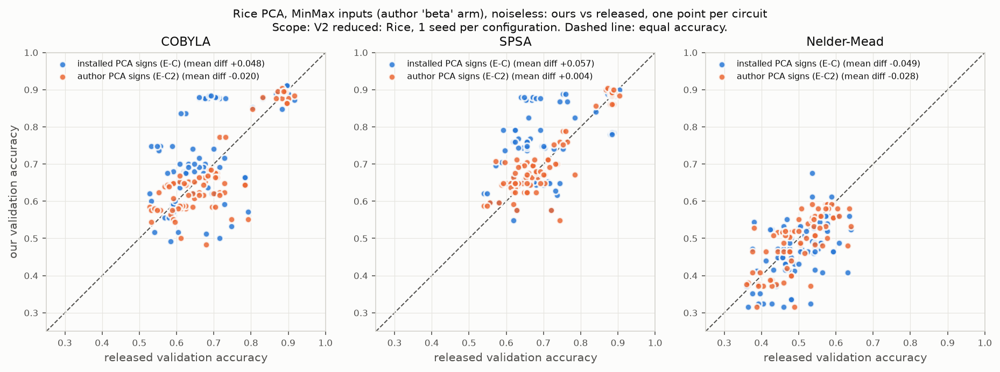
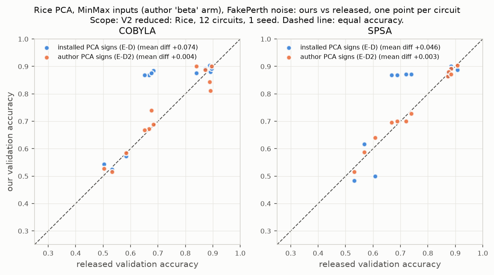

# On Optimizing Hyperparameters for Quantum Neural Networks - Reproduction

Status: Phase 3 (experiments) complete pending audit; Phase 4 (photonic
adaptation) executed, write-up in progress. `LOG.md` is the full record.

## Reference and Attribution

- Paper: *On Optimizing Hyperparameters for Quantum Neural Networks*, IEEE
  International Conference on Quantum Computing and Engineering (QCE 2024).
- Authors: Sabrina Herbst, Vincenzo De Maio, Ivona Brandic.
- arXiv: [2403.18579](https://arxiv.org/abs/2403.18579)
  (DOI 10.48550/arXiv.2403.18579).
- Original repository: <https://github.com/sabrinaherbst/hyperparameters_qnn>
  (code and released result CSVs; used here for the re-analysis and as the
  reference implementation). Cite the paper when using these results.

## Original Paper

The paper asks which hyperparameters matter when training gate-based quantum
neural network (QNN) classifiers. It trains Qiskit variational classifiers
(feature map + ansatz, sampler readout) on four tabular UCI datasets
(KDD Cup 1999, Cover Type, Glass Identification, Rice), each reduced to at most
seven features with PCA or LDA, so one feature is encoded per qubit. It sweeps
feature map (Z, ZZ) and its entanglement, ansatz (RealAmplitudes, EfficientSU2,
TwoLocal, PauliTwoDesign) and its entanglement, optimizer (COBYLA, SPSA,
Nelder-Mead) and parameter initialization (uniform, normal, beta), noiseless and
under an IBM Perth noise model. The metric is accuracy and weighted F1 on a
250-row validation sample.

Main claims: (C1) a beta-distribution initialization is significantly better
than uniform and normal; (C2) SPSA and COBYLA beat Nelder-Mead; (C3) the beta
value range, not its distribution, matters. Secondary claims cover ansatz,
entanglement, feature map, PCA vs LDA, the top configurations (Tables 2-5), and
the cost of noise.

## Reproduction Scope (including Updates and Deviations)

Experiments (IDs as in `LOG.md`):

| ID | What | Scope |
|---|---|---|
| E-A | Re-analysis of all 178 released result files: Tables 2-5, noise cost, the author's significance tests, and a new equivalence test between initialization arms | V1: all released results |
| E-B | Factorial separating input scaling {raw, MinMax} from an initial point that is actually applied {Qiskit default, beta, zeros}; 4 circuits x {COBYLA, SPSA} x 3 seeds | Rice, Glass; 288 runs |
| E-C, E-C2 | Faithful re-run of the noiseless Rice grid: 84 circuits x 3 optimizers x 2 arms (E-C), and the MinMax arm again with the author's PCA sign convention (E-C2) | Rice; 504 + 252 runs, 1 seed |
| E-D, E-D2 | FakePerth noisy subset: 12 circuits x {COBYLA, SPSA} x 2 arms, installed (E-D) and author (E-D2) PCA signs | Rice; 48 + 48 runs |
| E-F | Classical baselines (logistic regression, RBF SVM, parameter-matched MLP) on identical features | All four datasets; 420 runs |
| E-P | Photonic-native MerLin adaptation (Phase 4) of the E-B mechanism question | Rice, Glass; 144 runs |

Deviations and findings that change the reading of the paper:

- **The initialization is never applied in the author code.** The circuit's
  `assign_parameters` result is discarded, so every arm starts from the Qiskit
  default. The "beta" arms differ from the others only by MinMax-scaling the
  inputs to [0, 1]; the other arms feed raw PCA/LDA scores (Rice range about
  [-5.6, 5.7]) as rotation angles. E-B tests this directly.
- **Optimizer budgets are swapped in the author code** (SPSA and Nelder-Mead),
  and Nelder-Mead is capped at 1000 evaluations by Qiskit's default. We run the
  budgets as executed, so optimizer rankings are at unequal cost.
- **PCA sign convention.** The author used scikit-learn 1.2.2; scikit-learn 1.5
  changed the PCA sign rule, which negates two Rice components. This caused the
  first E-C/E-D MinMax-arm gap; E-C2/E-D2 rerun with the author convention
  (`dataset.pca_signs: "u_based"`).
- **Software port:** Qiskit 1.4 / qiskit-machine-learning 0.8 instead of 0.42 /
  0.6, with a batched statevector simulator checked against Qiskit to 1e-14.
- **Reduced re-training scope:** full KDD, Cover Type and Glass grid re-runs
  (about 10,000 runs) are out of scope; E-A covers them from the released
  results. Re-runs use 1 seed per circuit (E-C, E-D) or 3 seeds (E-B).
- **KDD, Cover Type and Glass noisy runs** in the paper used the live
  `ibm_perth` noise model; only Rice used `FakePerth`, which we use.
- **Photonic adaptation (Phase 4):** a MerLin reuploading classifier, not a
  translation of the Qiskit circuits (see below).

## Install and How to Run

```bash
python -m venv .venv
source .venv/bin/activate          # Windows: .venv\Scripts\activate
pip install -r papers/QNN_hyperparameters/requirements.txt
```

`requirements.txt` pins the CUDA 12.8 torch wheel on Linux (for the GPU server
used here) and a generic torch elsewhere.

Quick smoke runs (seconds to minutes, from the repository root):

```bash
python implementation.py --paper QNN_hyperparameters --config configs/smoke.json --seed 42
python implementation.py --paper QNN_hyperparameters --config configs/photonic_smoke.json --seed 42
python implementation.py --paper QNN_hyperparameters --config configs/reanalysis.json
```

Full experiments (sweeps; run on an 8-vCPU / NVIDIA L4 machine):

```bash
python implementation.py --paper QNN_hyperparameters --config configs/mechanism_factorial.json        # E-B
python implementation.py --paper QNN_hyperparameters --config configs/baselines_classical.json        # E-F
python implementation.py --paper QNN_hyperparameters --config configs/rice_grid_original.json         # E-C
python implementation.py --paper QNN_hyperparameters --config configs/rice_grid_author_signs.json     # E-C2
python implementation.py --paper QNN_hyperparameters --config configs/rice_grid_noisy_reduced.json    # E-D
python implementation.py --paper QNN_hyperparameters --config configs/rice_grid_noisy_author_signs.json  # E-D2
python implementation.py --paper QNN_hyperparameters --config configs/photonic_mechanism.json --device cuda:0  # E-P
```

From inside the paper folder, use `python ../../implementation.py --config configs/<name>.json`.

Analysis and figures (read the sweep artifacts, write to `results/`):

```bash
python papers/QNN_hyperparameters/utils/analyze_sweeps.py mechanism papers/QNN_hyperparameters/outdir/sweeps/E-B_mechanism
python papers/QNN_hyperparameters/utils/analyze_sweeps.py grid papers/QNN_hyperparameters/outdir/sweeps/E-C2_rice_grid_author_signs
python papers/QNN_hyperparameters/utils/analyze_sweeps.py noisy papers/QNN_hyperparameters/outdir/sweeps/E-D2_rice_noisy_author_signs --noiseless papers/QNN_hyperparameters/outdir/sweeps/E-C2_rice_grid_author_signs
python papers/QNN_hyperparameters/utils/analyze_sweeps.py baselines papers/QNN_hyperparameters/outdir/sweeps/E-F_baselines
python papers/QNN_hyperparameters/utils/analyze_sweeps.py photonic papers/QNN_hyperparameters/outdir/sweeps/E-P_photonic_mechanism
python papers/QNN_hyperparameters/utils/plot_grid_agreement.py <sweep_dir>... --labels <label>... --init beta --name <figure>
python papers/QNN_hyperparameters/utils/recompute_check.py --released <E-A run>/released_results_tidy.csv
```

Each run writes `outdir/run_YYYYMMDD-HHMMSS/` (`config_snapshot.json`,
`run.log`, `run_status.json`, `metrics.json`); sweeps write
`outdir/sweeps/<sweep>/` with one `runs/<run_id>/` per run plus `sweep.log`,
`sweep_status.json` and `summary.json`. Curated tables and figures are in
`results/`.

## Configuration

`cli.json` is the authoritative CLI schema. Paper-specific flags:

- `--mode {qnn, photonic, baseline, reanalysis, sweep}`
- `--dataset {rice, glass, cover_type, kdd_cup}`, `--preprocessing {pca, lda}`
- `--input-scaling {raw, minmax}` (MinMax is the author's "beta" arm preprocessing)
- `--optimizer {COBYLA, SPSA, NelderMead, Adam}` (Adam for photonic runs), `--maxiter`
- `--init {qiskit_default, uniform, beta, beta_mu, normal_beta, normal, zeros, merlin_default}`
  (`qiskit_default` is what the author runs actually used)
- `--workers` for sweeps

Global flags (`--config`, `--seed`, `--device`, `--dtype`, `--outdir`,
`--log-level`) come from the shared runtime. Notable config keys:
`dataset.pca_signs` (`installed` or `u_based`), `photonic.photons`,
`photonic.depth`, `training.steps`, `training.lr`.

## Data

Data lives under `data/QNN_hyperparameters/` (override with `DATA_DIR` or
`--data-root`); it is not committed.

- Cover Type and KDD Cup 1999 (10 % subset): scikit-learn caches in
  `sklearn_data_home/`. Glass Identification and Rice: UCI tables in
  `glass_identification/` and `rice/`. Licenses: Cover Type, Glass and Rice
  CC BY 4.0; KDD Cup 1999 has no stated license.
- Re-acquire with `python -I data/QNN_hyperparameters/sources/acquire_datasets.py <repo_root>`;
  checksums in `data/QNN_hyperparameters/SHA256SUMS.txt`.
- The paper PDF, the author repository and its released results are cached in
  `data/QNN_hyperparameters/sources/`.
- Splits follow the author code: 60/20/20 stratified (`random_state=5`), then a
  400/250/250 subsample (`random_state=12`).

## Results Obtained and Comparison with the Paper

### Released results re-analysed (E-A, all datasets)

| Quantity | Paper | Reproduced from released CSVs |
|---|---|---|
| Best noiseless F1: KDD / Cover Type / Rice / Glass | 0.965 / 0.612 / 0.915 / 0.571 | 0.965 / 0.612 / 0.915 / 0.571 |
| Mean noise cost: KDD / Cover Type / Rice / Glass | 10 / 4 / 3 / 7 % | 10.2 / 4.3 / 3.6 / 7.7 % |
| Beta vs uniform, normal (8 settings) | significant everywhere | +0.03 to +0.14, Wilcoxon p <= 2e-7 everywhere |
| COBYLA, SPSA vs Nelder-Mead | significant everywhere | +0.05 to +0.55, significant everywhere |
| Ansatz effect | none | none (Kruskal p 0.11-0.96) |

New test (E-A3): the six initialization arms form two classes,
{zero, uniform, normal} and {beta, beta_mu, normal_beta}. All 24 within-class
pairs are equivalent within +-0.02 (mean |diff| 0.004); no across-class pair is
(mean |diff| 0.167). This is what an unapplied initialization plus a scaling
difference predicts.

### What the "beta initialization" effect is (E-B, Rice and Glass)

Validation accuracy, paired effects (24 pairs each, Holm-corrected):

| Effect | Rice | Glass |
|---|---|---|
| MinMax - raw input scaling (per init) | +0.31 (all p = 0.0003) | +0.11 to +0.16 (p <= 0.004) |
| Applied beta or zeros initial point - default (fixed scaling) | -0.012 to -0.002, p = 1.0 | -0.026 to +0.021, p = 1.0 |

The paper's beta advantage is reproduced in size by MinMax input scaling alone
and is not produced by applying a beta initial point. C1 is refuted as stated;
C3 follows because the three beta-family arms are the same procedure.

### Faithful Rice re-runs (E-C2 noiseless, E-D2 noisy)




Our runs vs the released runs, paired by circuit, MinMax arm, author PCA signs:

| Sweep | Optimizer | Mean diff | Pearson (ours vs released) | Pearson (released replicate) |
|---|---|---:|---:|---:|
| E-C2 noiseless | COBYLA | -0.020 | 0.84 | 0.78 |
| E-C2 noiseless | SPSA | +0.004 | 0.88 | 0.86 |
| E-C2 noiseless | Nelder-Mead | -0.028 | 0.68 | n/a |
| E-D2 FakePerth | COBYLA | +0.004 | 0.96 | n/a |
| E-D2 FakePerth | SPSA | +0.003 | 0.99 | n/a |

Per-circuit agreement equals the released run-to-run agreement. The raw-input
arm (E-C) matches within the released replicate noise (mean diff within
+-0.002). The author's tests reach the paper's verdicts on our runs, except
COBYLA vs SPSA, which becomes significant because of the small COBYLA residual.
Noise costs about 1-2 % on Rice in our runs and the released ones (C9).

### Classical baselines (E-F)

On identical features and MinMax inputs, seed-mean validation accuracy of
logistic regression / RBF SVM matches or beats the *best* released QNN, which
is itself selected on the same validation rows: Rice 0.911 / 0.918 vs 0.916;
KDD LDA 0.968 / 0.973 vs 0.972; Cover Type LDA 0.680 / 0.673 vs 0.620; Glass
LDA 0.628 / 0.642 vs 0.628. Classical models are insensitive to input scaling,
so the scaling sensitivity is specific to angle encoding. The paper does not
claim a QNN advantage, and none is observed.

### Photonic adaptation (E-P, Phase 4, simulated)

Translation status `PARTIAL_MERLIN_TRANSLATION`: the mechanism question (input
scaling vs initialization) is translated; the Qiskit circuit grid is not.
Excluded, with reasons:
- Ansatz family and entanglement (C4, C5): a trainable MZI mesh is already
  universal on its modes, so the qubit ansatz families collapse to one mesh.
- Optimizer comparison (C2): the photonic model trains with exact-gradient Adam.
- LDA vs PCA (C7): a dataset-specific qubit-count question.
- FakePerth noise (C9): an IBM superconducting noise model.

Photon number and re-uploading depth take the place of the architecture factors.

Rejected mappings:
- Gate-level dual-rail transpilation: needs postselected two-qubit gates and
  keeps the syntax, not the role.
- A qubit-mimicking phase-encoding classifier: replaced, before any run, by
  the photonic-native design (`LOG.md`, amendment of 2026-10-28).
- A kernel or reservoir model: it has no trainable ansatz, so the init question
  disappears.
Model: `2d` modes for `d` features, `n` in {2, 4} photons, data reuploading
(trainable MZI mesh, then `depth` x [phase `pi * x_i` on mode `2i`, trainable
mesh]), per-mode photon expectations under threshold detection
(`ComputationSpace.UNBUNCHED`, no postselection) into a linear head, Adam on
exact gradients, MerLin 0.4.1 analytic simulator on an NVIDIA L4 (no shots, no
loss).

| Effect (validation, Holm-corrected) | Rice | Glass |
|---|---|---|
| MinMax - raw scaling | +0.37 to +0.38 (p = 0.007) | +0.13 to +0.17 (p = 0.007) |
| Beta or zeros init - MerLin default | -0.013 to +0.003 (p >= 0.125) | -0.029 to +0.017 (p = 1.0) |
| 4 vs 2 photons, depth 2 vs 1 | within +-0.02, not significant | within +-0.02, not significant |

The predeclared preservation rule is met: the photonic classifier shows the
same mechanism as the qubit model. Cite the significance pattern, not the exact
effect sizes. A rerun of the same configs and seeds on the same GPU kept every
verdict but moved individual effects by up to 0.03. CUDA arithmetic is not
deterministic, and small differences grow during training (see "Reproducibility
of the committed results" below). MinMax accuracy is 0.90-0.92 (Rice) and
0.60-0.61 (Glass), above the qubit E-B cells (0.81-0.82, 0.43-0.45) and at the
level of the classical baselines; this is not a matched comparison (different
optimizer, parameter count and readout head) and is left to Phase 5.
Hardware-aware fields (from each run's `metrics.json["hardware"]`):

| Field | Value |
|---|---|
| Computation space, detector | `UNBUNCHED`, threshold |
| Photons, modes, input state | 2 or 4 photons spread over 14 (Rice) or 10 (Glass) modes, e.g. Rice 4 photons `[1,0,0,1,0,0,0,1,0,0,1,0,0,0]` |
| Encoding | phase `pi * x_i` on mode `2i`, re-uploaded 1 or 2 times between trainable MZI meshes |
| Measurement, postselection | per-mode photon expectations into a linear head; no postselection |
| Simulator, shots | MerLin 0.4.1 analytic simulator on an NVIDIA L4; exact expectations, no shots, no loss |
| Gradients | exact autograd (Adam); not hardware-realizable as is |
| Seeds, wall-clock | seeds 1-3; 38-131 s training per run (8 runs sharing the GPU), 25 min for all 144 runs |

These are simulator results, not hardware validation. Per-configuration timing
and parameter counts are in `LOG.md` ("Phase 4 Hardware-Aware Report").

### Reproducibility of the committed results

The sweeps behind every table were first run from an uncommitted working tree,
so their run records carry commit `e7beb6a` (dirty). To tie the results to code,
each sweep was rerun on the same machine from a clean checkout of `861a180`,
the commit that contains them, with identical configs and seeds:

| Sweep | Rerun outcome |
|---|---|
| E-B, E-C, E-C2, E-F | Tables identical |
| E-D (noisy) | Same verdicts; agreement within 0.015 of the committed table |
| E-P (photonic, GPU) | Same verdicts; individual effects moved by up to 0.03 (predeclared tolerance 0.01 not met) |
| E-D2 (noisy) | Not rerun: stopped at 7/48 runs by decision. It combines the E-C2 preprocessing with the E-D noise path, and both were rerun successfully |

The noisy runs (E-D, E-D2) use an unseeded Aer sampler, so the same code and
seeds move a single configuration's accuracy by up to about 0.1 between runs.
Aggregate agreement is stable. `utils/recompute_check.py` rebuilds every table
from the raw run metrics and matches to 6.7e-16.

## Limitations

- Re-training covers Rice (grid, noisy subset) and Rice + Glass (mechanism);
  KDD, Cover Type and Glass grids are analysed from released results only.
- One seed per circuit in E-C/E-D; E-B uses 3 seeds and 4 circuits.
- Residual offsets after the sign fix: COBYLA -0.02 and Nelder-Mead -0.03 on the
  noiseless Rice grid, within single-configuration run-to-run spread.
- Glass has 43 validation rows, so its effects have wide intervals (about
  +-0.06 for init effects).
- The committed results come from runs that record commit `e7beb6a` with
  uncommitted paper code, so the exact code state of those runs cannot be
  identified. Clean-commit reruns at `861a180` reproduce E-B, E-C, E-C2, E-D
  and E-F under the predeclared rules. E-P keeps its verdicts but not its
  effect sizes within 0.01. E-D2 was not rerun.
- E-D and E-D2 build the noisy Aer sampler without a seed (`lib/qnn.py`), so
  noisy runs are not bit-reproducible.
- Photonic results are simulator-only (no QPU, no photon loss, exact
  expectations).

## Tests

```bash
cd papers/QNN_hyperparameters
pytest -q
```

Tests cover data loading and PCA sign conventions, sweep sizes, simulator
agreement with Qiskit, the released-results parser, and the photonic model
(state layout, parameter registration, reuploading, seeding, gradients, and the
analysis on a planted effect).

## Citation and License

```bibtex
@inproceedings{herbst2024hyperparameters,
  title     = {On Optimizing Hyperparameters for Quantum Neural Networks},
  author    = {Herbst, Sabrina and De Maio, Vincenzo and Brandic, Ivona},
  booktitle = {IEEE International Conference on Quantum Computing and Engineering (QCE)},
  year      = {2024},
  eprint    = {2403.18579},
  archivePrefix = {arXiv}
}
```

Datasets are from the UCI Machine Learning Repository (licenses above).
