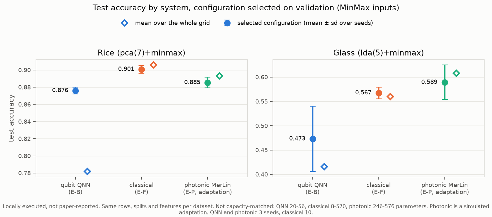

# On Optimizing Hyperparameters for Quantum Neural Networks — Reproduction

Status: reproduction (Phase 3), photonic adaptation (Phase 4) and fair
comparison (Phase 5) complete and audited. The paper's headline
initialization result does not hold as stated. The effect it measures is real,
but it comes from input scaling, not from the initialization.

## Reference and Attribution

- Paper: *On Optimizing Hyperparameters for Quantum Neural Networks*, IEEE
  International Conference on Quantum Computing and Engineering (QCE 2024).
- Authors: Sabrina Herbst, Vincenzo De Maio, Ivona Brandic.
- arXiv: [2403.18579](https://arxiv.org/abs/2403.18579)
  (DOI 10.48550/arXiv.2403.18579).
- Original repository: <https://github.com/sabrinaherbst/hyperparameters_qnn>
  (commit 53bc59a). It holds the code and the released result CSVs, used here
  for the re-analysis and as the reference implementation. Cite the paper when
  using these results.

## Original Paper

The paper asks which hyperparameters matter when training gate-based quantum
neural network (QNN) classifiers.

- **Model:** Qiskit variational classifiers (feature map + ansatz, sampler
  readout).
- **Data:** four tabular UCI datasets (KDD Cup 1999, Cover Type, Glass
  Identification, Rice), each reduced to at most seven features with PCA or LDA,
  so one feature is encoded per qubit.
- **Swept:**
  - feature map (Z, ZZ) and its entanglement;
  - ansatz (RealAmplitudes, EfficientSU2, TwoLocal, PauliTwoDesign) and its
    entanglement;
  - optimizer (COBYLA, SPSA, Nelder-Mead);
  - parameter initialization (uniform, normal, beta);
  - noiseless, and under an IBM Perth noise model.
- **Metric:** accuracy and weighted F1 on a 250-row validation sample.

Main claims:
- **C1:** a beta-distribution initialization is significantly better than
  uniform and normal.
- **C2:** SPSA and COBYLA beat Nelder-Mead, and COBYLA is faster.
- **C3:** the beta value range, not its distribution, matters.
- Secondary claims (C4-C9): ansatz, entanglement, feature map, PCA vs LDA, the
  top configurations (Tables 2-5), and the cost of noise.
- The paper makes no claim of advantage over classical models.

## Reproduction Scope, Claims, and Deviations

Experiments (IDs as in `LOG.md`):

| ID | What | Scope |
|---|---|---|
| E-A | Re-analysis of the released results (197 files, 178 with rows): Tables 2-5, noise cost, the author's significance tests, and a new equivalence test between initialization arms | V1: all released results |
| E-B | Factorial separating input scaling {raw, MinMax} from an initial point that is actually applied {Qiskit default, beta, zeros}; 4 circuits x {COBYLA, SPSA} x 3 seeds | Rice, Glass; 288 runs |
| E-C, E-C2 | Faithful re-run of the noiseless Rice grid: 84 circuits x 3 optimizers x 2 arms (E-C), and the MinMax arm again with the author's PCA sign convention (E-C2) | Rice; 504 + 252 runs, 1 seed |
| E-D, E-D2 | FakePerth noisy subset: 12 circuits x {COBYLA, SPSA} x 2 arms, installed (E-D) and author (E-D2) PCA signs | Rice; 48 + 48 runs, 1 seed |
| E-F | Classical baselines (logistic regression, RBF SVM, parameter-matched MLP) on identical features | All four datasets; 420 runs, 10 seeds |
| E-P | Photonic-native MerLin adaptation of the E-B mechanism question | Rice, Glass; 144 runs, 3 seeds |

Deviations, and findings that change how the paper reads:

- **The initialization is never applied in the author code.** The result of the
  circuit's `assign_parameters` call is discarded, so every arm starts from the
  Qiskit default. The "beta" arms differ from the others only in MinMax-scaling
  the inputs to [0, 1]. The other arms feed raw PCA/LDA scores as rotation
  angles (Rice range about [-5.6, 5.7]). E-B tests this directly.
- **Optimizer budgets are swapped in the author code** (SPSA and Nelder-Mead),
  and Qiskit's default caps Nelder-Mead at 1000 evaluations. We run the budgets
  as executed, so optimizer rankings are at unequal cost.
- **PCA sign convention.** The author used scikit-learn 1.2.2. scikit-learn 1.5
  changed the PCA sign rule, which negates two Rice components. This caused the
  first E-C/E-D MinMax-arm gap; E-C2/E-D2 rerun with the author convention
  (`dataset.pca_signs: "u_based"`).
- **Software port:** Qiskit 1.4 and qiskit-machine-learning 0.8 instead of 0.42
  and 0.6, with a batched statevector simulator checked against Qiskit to 1e-14.
- **Reduced re-training scope:** full KDD, Cover Type and Glass grid re-runs
  (about 10,000 runs) are out of scope (F2, compute); E-A covers them from the
  released results. Re-runs use 1 seed per circuit (E-C, E-D) or 3 seeds (E-B).
- **Noise model:** in the paper, the KDD, Cover Type and Glass noisy runs used
  the live `ibm_perth` noise model. Only Rice used `FakePerth`, which is what we
  use.
- **Test split:** the author code loads it but never scores it. We report test
  accuracy alongside validation.

## Project Layout

```text
papers/QNN_hyperparameters/
|-- README.md, FEEDBACK.md, INSIGHTS.md, CONFLUENCE.md
|-- ACTION_REQUIRED_SEND_TO_MERLIN_TEAM.md   MerLin bugs and requests found here
|-- cli.json, requirements.txt
|-- configs/        defaults, smoke, one config per sweep (E-B ... E-P)
|-- lib/            data.py, circuits.py, simulator.py, qnn.py (Qiskit port),
|                   photonic.py (MerLin), baselines.py, reanalysis.py,
|                   sweep.py, sweep_analysis.py, runner.py, experiment_logging.py
|-- utils/          analyze_sweeps.py, recompute_check.py, compare_systems.py,
|                   plot_grid_agreement.py, plot_phase5_comparison.py
|-- tests/          pytest suite
|-- results/        curated tables and figures (committed)
`-- outdir/         raw runs and sweeps (not committed)
```

## Install and How to Run

```bash
python -m venv .venv
source .venv/bin/activate          # Windows: .venv\Scripts\activate
pip install -r papers/QNN_hyperparameters/requirements.txt
```

`requirements.txt` pins `perceval-quandela<1.3`, because `merlinquantum` 0.4.1
fails to import with 1.3. It also pins the CUDA 12.8 torch wheel on Linux, for
the GPU server used here, and a generic torch elsewhere.

Quick smoke runs (seconds to minutes, from the repository root):

```bash
python implementation.py --paper QNN_hyperparameters --config configs/smoke.json --seed 42
python implementation.py --paper QNN_hyperparameters --config configs/photonic_smoke.json --seed 42
python implementation.py --paper QNN_hyperparameters --config configs/reanalysis.json
```

Full experiments (sweeps; run on an 8-vCPU / NVIDIA L4 machine):

```bash
python implementation.py --paper QNN_hyperparameters --config configs/mechanism_factorial.json        # E-B
python implementation.py --paper QNN_hyperparameters --config configs/baselines_classical.json        # E-F
python implementation.py --paper QNN_hyperparameters --config configs/rice_grid_original.json         # E-C
python implementation.py --paper QNN_hyperparameters --config configs/rice_grid_author_signs.json     # E-C2
python implementation.py --paper QNN_hyperparameters --config configs/rice_grid_noisy_reduced.json    # E-D
python implementation.py --paper QNN_hyperparameters --config configs/rice_grid_noisy_author_signs.json  # E-D2
python implementation.py --paper QNN_hyperparameters --config configs/photonic_mechanism.json --device cuda:0  # E-P
```

From inside the paper folder, use `python ../../implementation.py --config configs/<name>.json`.

Analysis and figures (read the sweep artifacts, write to `results/`):

```bash
python papers/QNN_hyperparameters/utils/analyze_sweeps.py mechanism papers/QNN_hyperparameters/outdir/sweeps/E-B_mechanism
python papers/QNN_hyperparameters/utils/analyze_sweeps.py grid papers/QNN_hyperparameters/outdir/sweeps/E-C2_rice_grid_author_signs
python papers/QNN_hyperparameters/utils/analyze_sweeps.py noisy papers/QNN_hyperparameters/outdir/sweeps/E-D2_rice_noisy_author_signs --noiseless papers/QNN_hyperparameters/outdir/sweeps/E-C2_rice_grid_author_signs
python papers/QNN_hyperparameters/utils/analyze_sweeps.py baselines papers/QNN_hyperparameters/outdir/sweeps/E-F_baselines
python papers/QNN_hyperparameters/utils/analyze_sweeps.py photonic papers/QNN_hyperparameters/outdir/sweeps/E-P_photonic_mechanism
python papers/QNN_hyperparameters/utils/plot_grid_agreement.py <sweep_dir>... --labels <label>... --init beta --name <figure>
python papers/QNN_hyperparameters/utils/recompute_check.py --released <E-A run>/released_results_tidy.csv
python papers/QNN_hyperparameters/utils/compare_systems.py papers/QNN_hyperparameters/outdir/sweeps  # Phase 5 tables
python papers/QNN_hyperparameters/utils/plot_phase5_comparison.py papers/QNN_hyperparameters/results/phase5_systems.csv
```

Each run writes `outdir/run_YYYYMMDD-HHMMSS/` (`config_snapshot.json`,
`run.log`, `run_status.json`, `metrics.json`). Sweeps write
`outdir/sweeps/<sweep>/`, with one `runs/<run_id>/` per run plus `sweep.log`,
`sweep_status.json` and `summary.json`. Curated tables and figures are in
`results/`.

## Configuration

`cli.json` is the authoritative CLI schema. Paper-specific flags:

- `--mode {qnn, photonic, baseline, reanalysis, sweep}`
- `--dataset {rice, glass, cover_type, kdd_cup}`, `--preprocessing {pca, lda}`
- `--input-scaling {raw, minmax}`: MinMax is the preprocessing of the author's
  "beta" arms.
- `--optimizer {COBYLA, SPSA, NelderMead, Adam}`, `--maxiter`: Adam is for
  photonic runs.
- `--init {qiskit_default, uniform, beta, beta_mu, normal_beta, normal, zeros, merlin_default}`:
  `qiskit_default` is what the author runs actually used.
- `--workers`: parallel workers for sweeps.

Global flags (`--config`, `--seed`, `--device`, `--dtype`, `--outdir`,
`--log-level`) come from the shared runtime. Notable config keys:
`dataset.pca_signs` (`installed` or `u_based`), `photonic.photons`,
`photonic.depth`, `training.steps`, `training.lr`.

## Data

Data lives under `data/QNN_hyperparameters/`. Override it with `DATA_DIR` or
`--data-root`. It is not committed.

- **Sources:**
  - Cover Type and KDD Cup 1999 (10 % subset): downloaded with scikit-learn's
    `fetch_covtype` / `fetch_kddcup99` into `sklearn_data_home/`.
  - Glass Identification and Rice (Cammeo and Osmancik): UCI tables in
    `glass_identification/` and `rice/`.
  - Licenses: Cover Type, Glass and Rice are CC BY 4.0. KDD Cup 1999 has no
    stated license.
- **Re-acquire:** `python -I data/QNN_hyperparameters/sources/acquire_datasets.py <repo_root>`.
  Checksums are in `data/QNN_hyperparameters/SHA256SUMS.txt`. No fallback or
  synthetic data was used.
- **Reference material:** the paper PDF, the author repository and its released
  results are cached in `data/QNN_hyperparameters/sources/`.
- **Transformations** follow the author code (`lib/data.py`):
  1. 60/20/20 stratified split, `random_state=5`.
  2. KDD only: one-hot encode `protocol_type`, `service` and `flag`, then drop
     one feature of every pair with |correlation| > 0.9.
  3. PCA (7 components) on standardized features, or LDA (`min(7, n_classes-1)`
     components) on raw features. Both are fit on the training split.
  4. Subsample 400 training and 250 validation rows (`random_state=12`), plus
     250 test rows the same way. Glass has only 214 rows, so its splits are
     128/43/43.
  5. Optional MinMax scaling to [0, 1], fit on the training rows.

## Results Obtained and Comparison with the Paper

All values are locally executed or recomputed from the released CSVs, as
labelled. Paper values are from the paper's text, tables and figures.

### Claim-level results

| Paper item | Claim tested | Paper value | Reproduced value | Delta | Metric agreement | Trend agreement | Claim support | Seeds | Comment |
|---|---|---:|---:|---:|---|---|---|---:|---|
| Tables 2-5 (released) | C8 best noiseless F1, KDD / Cover / Rice / Glass | 0.965 / 0.612 / 0.915 / 0.571 | 0.965 / 0.612 / 0.915 / 0.571 | 0 | exact | yes | reproduced (descriptive) | 1 run per config (author) | E-A1. Selected on the same validation rows that are scored. |
| Table 4 (re-run) | C8 best Rice accuracy, noiseless | 0.916 | 0.912 | -0.004 | within run-to-run spread | yes | reproduced | 1 | E-C, ported implementation |
| Fig. 3 (released) | C9 mean noise cost, KDD / Cover / Rice / Glass | 10 / 4 / 3 / 7 % | 10.2 / 4.3 / 3.6 / 7.7 % | +0.2 to +0.7 pt | yes (rounding) | yes | reproduced | 1 run per config | E-A1 |
| Fig. 3 (re-run, Rice) | C9 noise effect, MinMax arm, COBYLA / SPSA | -0.018 / -0.010 (released runs) | -0.006 / -0.016 | +0.012 / -0.006 | approximate | yes (small cost) | supported | 1 | E-D2 vs E-C2. Noisy sampler unseeded. |
| Table 7, Fig. 4 | C1 beta init > normal / uniform | significant everywhere (p < 1e-4) | released: +0.03 to +0.14, p <= 2e-7 in all 8 settings | n/a | yes (released data) | yes | **unsupported as stated** | released 1; E-B 3 | E-B: applied init has no effect (Holm p = 1.0). MinMax scaling gives +0.31 (Rice) and +0.11-0.16 (Glass). |
| Table 6, Sec. 6 | C3 beta-family arms equivalent; range matters | mostly not significant | 24/24 within-class pairs TOST-equivalent at +-0.02 | n/a | yes | yes | partially supported | released 1 | E-A3. The range that matters is the input range: no init is applied. |
| Figs. 5, 6, 11 | C2 COBYLA, SPSA > Nelder-Mead; COBYLA faster | significant everywhere | +0.05 to +0.55, significant everywhere; COBYLA 2x faster than SPSA (p = 1.7e-13) | n/a | yes | yes | partially supported | released 1; E-B 3 | Budgets unequal and swapped in the author code. Equal-cost comparison not run. |
| Fig. 7 | C4 no ansatz effect | none | Kruskal p 0.11-0.96 (released); p = 0.98 (E-C) | n/a | yes | yes | supported | 1 | |
| App. Tables 9-10 | C5 no consistent entanglement effect | none consistent | significant in 4/8 (ansatz) and 5/8 (feature map) settings, spreads < 0.03 | n/a | partial | direction yes | partially supported | 1 | E-A2 |
| Figs. 8-9 | C6 "beta" boost larger for ZZ | +12-16 % (ZZ) vs +2-5 % (Z) | Z > ZZ on Cover Type, Glass, KDD noiseless; boost size not recomputed | n/a | not checked | partial | partially supported | 1 | E-A2 |
| Fig. 10 | C7 LDA > PCA | most settings | Glass yes; KDD no (PCA > LDA, p < 1e-5) | n/a | partial | partial | partially supported | 1 | LDA changes the qubit count. The E-F classical models do not share the KDD ordering. |
| (re-run agreement) | per-circuit agreement, E-C2 noiseless (MinMax arm) | released runs | mean diff -0.020 / +0.004 / -0.028 (COBYLA / SPSA / NM); Pearson 0.84 / 0.88 / 0.68 | see left | within the released replicate spread (Pearson 0.78 / 0.86) | yes | supports the port | 1 | Author PCA signs |
| (re-run agreement) | per-circuit agreement, E-D2 noisy (MinMax arm) | released runs | mean diff +0.004 / +0.003; Pearson 0.96 / 0.99 | see left | yes | yes | supports the port | 1 | Primary noisy comparison |

New test (E-A3): the six initialization arms form two classes,
{zero, uniform, normal} and {beta, beta_mu, normal_beta}. All 24 within-class
pairs are equivalent within ±0.02 (mean |diff| 0.004); no across-class pair is
(mean |diff| 0.167). That is what an unapplied initialization combined with a
scaling difference predicts.

### What the "beta initialization" effect is (E-B, Rice and Glass)

Validation accuracy, paired effects (24 pairs each, Holm-corrected):

| Effect | Rice | Glass |
|---|---|---|
| MinMax - raw input scaling (per init) | +0.31 (all p = 0.0003) | +0.11 to +0.16 (p <= 0.004) |
| Applied beta or zeros initial point - default (fixed scaling) | -0.012 to -0.002, p = 1.0 | -0.026 to +0.021, p = 1.0 |

MinMax input scaling alone reproduces the paper's beta advantage in size.
Applying a beta initial point does not produce it. C1 is refuted as stated; C3
follows because the three beta-family arms are the same procedure.

### Faithful Rice re-runs (E-C2 noiseless, E-D2 noisy)


- **Agreement:** per circuit, our runs agree with the released runs as well as
  the released replicates agree with each other (claim table above).
- **Raw-input arm (E-C):** matches within the released replicate noise (mean
  diff within ±0.002).
- **Author's tests:** applied to our runs, they reach the paper's verdicts,
  except COBYLA vs SPSA, which becomes significant because of the small COBYLA
  residual.
- **Noise (C9):** costs about 1-2 % on Rice, in our runs and in the released
  ones.

### Sweep records

Every sweep is a **complete sweep**: observed runs equal the plan, all
validated. Metric: accuracy, maximized, on the 250-row validation sample (Glass:
43 rows). Test accuracy is reported alongside. Checkpoint: final parameters.

| Sweep | Runs (observed / expected) | Purpose | Selection | Full candidate tables |
|---|---:|---|---|---|
| E-B | 288 / 288 | paired effects, no winner selected | n/a (paired Wilcoxon, Holm) | `results/E-B_mechanism_{cell_means_val,cell_means_test,effects_val,effects_test}.csv` |
| E-C | 504 / 504 | agreement with released runs | n/a | `results/E-C_rice_grid_{per_config,agreement,author_tests}.csv` |
| E-C2 | 252 / 252 | agreement, author PCA signs | n/a | `results/E-C2_rice_grid_author_signs_{per_config,agreement,author_tests}.csv` |
| E-D | 48 / 48 | noisy agreement, noise effect | n/a | `results/E-D_rice_noisy_{per_config,agreement,noise_effect}.csv` |
| E-D2 | 48 / 48 | noisy agreement, author signs | n/a | `results/E-D2_rice_noisy_author_signs_{per_config,agreement,noise_effect}.csv` |
| E-F | 420 / 420 | classical context; hyperparameters by 5-fold CV on train | per seed, CV on train only | `results/E-F_baselines_baselines_vs_qnn.csv` |
| E-P | 144 / 144 | paired effects | n/a | `results/E-P_photonic_mechanism_{cell_means_val,cell_means_photons_val,effects_val,effects_test}.csv` |
| Phase 5 | uses E-B, E-F, E-P | best seed-mean validation configuration per family | see "Fair Baselines" | `results/phase5_{systems,near_tied_selection,separation,separation_sensitivity}.csv` |

`utils/recompute_check.py` independently rebuilds, from each run's
`metrics.json` and run id, every effects, agreement, noise-effect and baseline
table above and the five Phase 5 CSVs (systems, separation, matched capacity,
near-tied selection, separation sensitivity). Largest discrepancy: 6.7e-16.
Not recomputed: bootstrap confidence intervals and timing columns.

### Reproducibility of the committed results

The sweeps behind every table were first run from an uncommitted working tree,
so their run records carry commit `e7beb6a` (dirty). To tie the results to code,
each sweep was rerun on the same machine from a clean checkout of `861a180`,
the commit that contains them, with identical configs and seeds:

| Sweep | Rerun outcome |
|---|---|
| E-B, E-C, E-C2, E-F | Tables identical |
| E-D (noisy) | Same verdicts; agreement within 0.015 of the committed table |
| E-P (photonic, GPU) | Same verdicts; individual effects moved by up to 0.03 (predeclared tolerance 0.01 not met) |
| E-D2 (noisy) | Not rerun: stopped at 7/48 runs by decision. It combines the E-C2 preprocessing with the E-D noise path, and both were rerun successfully |

The noisy runs (E-D, E-D2) use an unseeded Aer sampler. With the same code and
seeds, a single configuration's accuracy moves by up to about 0.1 between runs.
Aggregate agreement is stable.

## Fair Baselines

The paper claims no quantum advantage. Its claims compare choices inside a QNN,
so the fair controls are internal. Baseline state per claim:

- **C1/C3: missing or unfair.** The beta arm alone gets MinMax-scaled inputs,
  and no initialization is applied. The fair control is E-B: same circuits, same
  scaling, initial point actually applied.
- **C2: fair and reproduced for the claim as executed** (identical
  configurations). Fairness is unresolved for an equal-cost reading, because
  budgets are unequal.
- **C7: missing or unfair.** LDA changes the qubit count. The control is E-F
  classical models on the same features.
- **Context, no advantage claimed:** E-F, with the MLP parameter-matched to the
  QNN (28 parameters on Rice, 30 on Glass vs 20 for the QNN).



Protocol, frozen before the table:
- Same rows, splits and features for every system (checked by the script).
- MinMax inputs.
- In each family, select the configuration with the best seed-mean validation
  accuracy and report its test accuracy.
- Two systems count as separated only if their means differ by more than one
  test sample and by more than twice the larger seed sd.

| Test accuracy, MinMax | Qubit QNN (E-B) | Classical (E-F) | Photonic MerLin (E-P, adaptation) |
|---|---|---|---|
| Rice, selected | 0.876 ± 0.004 (28 params) | 0.901 ± 0.005 (RBF-SVM) | 0.885 ± 0.006 (576 params) |
| Rice, parameter-matched | 0.876 ± 0.004 (28) | 0.908 ± 0.004 (MLP, 28) | not matched |
| Glass, selected | 0.473 ± 0.067 (20 params) | 0.567 ± 0.012 (RBF-SVM) | 0.589 ± 0.036 (246 params) |

**Selection ties:** the protocol had no tie rule for the validation selection,
and the selected configurations are fragile.
- On Glass the two best photonic configurations tie exactly on validation.
- Several families have candidates within one validation sample of their best.

Re-scoring every pair over all near-tied candidates
(`results/phase5_separation_sensitivity.csv`):

| Pair | Combinations | Outcome |
|---|---:|---|
| Rice: classical vs qubit QNN | 8 | classical higher in 7 (**robust**); the parameter-matched MLP is +0.032, separated |
| Rice: classical vs photonic | 10 | classical higher in 3, otherwise not separated (selection-sensitive) |
| Rice: photonic vs qubit QNN | 20 | photonic higher in 7, otherwise not separated (selection-sensitive) |
| Glass: classical vs qubit QNN | 4 | classical higher in 2, otherwise not separated |
| Glass: photonic vs qubit QNN | 8 | photonic higher in 5, otherwise not separated |
| Glass: photonic vs classical | 8 | photonic higher in 3, otherwise not separated |

Only one conclusion is robust: on Rice, classical models beat the qubit QNN,
including at matched parameter count.

The qubit QNN is never separated above another system. The Glass cases where
the photonic adaptation comes out higher rest on:
- 3-seed means over 43 test rows;
- about 10x the QNN's parameters;
- a simulator with exact gradients.

They are **unresolved**, not evidence of a photonic advantage. No quantum or
photonic advantage is claimed.

**Timing** (merlin-ai, 8 workers):
- **Training time per run (means per dataset):**
  - qubit QNN: 3-38 s on CPU;
  - photonic: 51-105 s on a shared L4;
  - classical: 1.1-1.5 s, at most 4 s, including the CV grid (timestamps at
    1 s resolution).
- **COBYLA vs SPSA:** on identical configurations, COBYLA trains 2x faster
  (Wilcoxon p = 1.7e-13). It stops on its tolerance after 138-163 loss
  evaluations, against SPSA's fixed 351. That supports the paper's speed claim
  at its budgets.

## Photonic Assessment and MerLin Extension

Translation status: **`PARTIAL_MERLIN_TRANSLATION`**. This is an adaptation,
not a reproduction.

- **Translated:** the mechanism question, input scaling vs initialization. The
  Qiskit circuit grid is not translated.
- **Excluded, with reasons:**
  - Ansatz family and entanglement (C4, C5): a trainable MZI mesh is already
    universal on its modes, so the qubit ansatz families collapse to one mesh.
  - Optimizer comparison (C2): the photonic model trains with exact-gradient
    Adam.
  - LDA vs PCA (C7): a dataset-specific qubit-count question.
  - FakePerth noise (C9): an IBM superconducting noise model.
- **Added factors:** photon number and re-uploading depth stand in for the
  architecture factors.
- **Rejected mappings:**
  - Gate-level dual-rail transpilation: needs postselected two-qubit gates,
    and keeps the syntax, not the role.
  - A qubit-mimicking phase-encoding classifier: replaced, before any run, by
    the photonic-native design (`LOG.md`, amendment of 2026-10-28).
  - A kernel or reservoir model: it has no trainable ansatz, so the init
    question disappears.

**Model:**
- `2d` modes for `d` features, and `n` in {2, 4} photons.
- Data reuploading: a trainable MZI mesh, then `depth` x [phase `pi * x_i` on
  mode `2i`, trainable mesh].
- Readout: per-mode photon expectations (`MeasurementStrategy.mode_expectations`)
  into a linear head.
- Training: Adam, 200 full-batch steps, lr 0.05.
- Patterns: MerLin cookbook data reuploading (0.5.3) and the `QuantumLayer` +
  measurement-strategy pattern.

| Effect (validation, Holm-corrected) | Rice | Glass |
|---|---|---|
| MinMax - raw scaling | +0.37 to +0.38 (p = 0.007) | +0.13 to +0.17 (p = 0.007) |
| Beta or zeros init - MerLin default | -0.013 to +0.003 (p >= 0.125) | -0.029 to +0.017 (p = 1.0) |
| 4 vs 2 photons, depth 2 vs 1 | within ±0.02, not significant | within ±0.02, not significant |

The predeclared preservation rule is met: the photonic classifier shows the
same mechanism as the qubit model.

Cite the significance pattern, not the exact effect sizes. A rerun with the
same configs and seeds on the same GPU kept every verdict but moved individual
effects by up to 0.03. CUDA arithmetic is not deterministic, and small
differences grow during training.

Two MerLin issues found here are in `ACTION_REQUIRED_SEND_TO_MERLIN_TEAM.md`:
- the `mode_expectations` mask stays on the CPU for CUDA layers (worked around
  in `lib/photonic.py`);
- the missing `perceval-quandela<1.3` cap.

## Hardware-Aware Settings

Values from each run's `metrics.json["hardware"]`:

| Field | Value |
|---|---|
| Computation space, detector | `UNBUNCHED`, threshold |
| Photons, modes, input state | 2 or 4 photons spread over 14 (Rice) or 10 (Glass) modes, e.g. Rice 4 photons `[1,0,0,1,0,0,0,1,0,0,1,0,0,0]` |
| Encoding | phase `pi * x_i` on mode `2i`, re-uploaded 1 or 2 times between trainable MZI meshes |
| Measurement, postselection | per-mode photon expectations into a linear head; no postselection |
| Simulator, shots | MerLin 0.4.1 analytic simulator (perceval-quandela 1.2.4) on an NVIDIA L4; exact expectations, no shots, no loss |
| Gradients | exact autograd (Adam); not realisable on hardware as is |
| Parameters | 180-546 trainable phases plus the linear head (246-576 in total) |
| Seeds, wall-clock | seeds 1-3; 38-131 s training per run (8 runs sharing the GPU), 25 min for all 144 runs |

These are simulator results, not hardware validation. Per-configuration timing
and parameter counts are in `LOG.md` ("Phase 4 Hardware-Aware Report").

## Limitations

- **Re-training scope:** Rice (grid, noisy subset), and Rice + Glass
  (mechanism). The KDD, Cover Type and Glass grids are analysed from released
  results only.
- **Seeds and circuits:** one seed per circuit in E-C/E-D; E-B uses 3 seeds and
  4 circuits.
- **Residual offsets after the sign fix:** COBYLA -0.02 and Nelder-Mead -0.03 on
  the noiseless Rice grid, within single-configuration run-to-run spread.
- **Glass:** 43 validation and 43 test rows, so its effects have wide intervals
  (about ±0.06 for init effects), and no Glass system comparison is robust.
- **Phase 5 selection:** no tie rule was declared for it, and its separations
  other than classical vs QNN on Rice depend on the selected configuration.
- **Provenance:** the committed results come from runs that record commit
  `e7beb6a` with uncommitted paper code, so the exact code state of those runs
  cannot be identified.
  - Clean-commit reruns at `861a180` reproduce E-B, E-C, E-C2, E-D and E-F
    under the predeclared rules.
  - E-P keeps its verdicts, but not its effect sizes within 0.01.
  - E-D2 was not rerun.
  - The user accepted this as a documented limitation.
- **Unseeded noise:** E-D and E-D2 build the noisy Aer sampler without a seed
  (`lib/qnn.py`), so noisy runs are not bit-reproducible.
- **Equal-cost optimizers:** not compared; budgets follow the author code.
- **Photonic:** simulator-only results (no QPU, no photon loss, exact
  expectations), at about 10x the QNN's parameter count.

## Tests

```bash
cd papers/QNN_hyperparameters
pytest -q
```

Coverage:
- data loading and PCA sign conventions;
- sweep sizes;
- simulator agreement with Qiskit;
- the released-results parser;
- the photonic model: state layout, parameter registration, reuploading,
  seeding, gradients, and the analysis on a planted effect.

## Citation and License

```bibtex
@inproceedings{herbst2024hyperparameters,
  title     = {On Optimizing Hyperparameters for Quantum Neural Networks},
  author    = {Herbst, Sabrina and De Maio, Vincenzo and Brandic, Ivona},
  booktitle = {IEEE International Conference on Quantum Computing and Engineering (QCE)},
  year      = {2024},
  eprint    = {2403.18579},
  archivePrefix = {arXiv}
}
```

Datasets are from the UCI Machine Learning Repository (licenses above).
