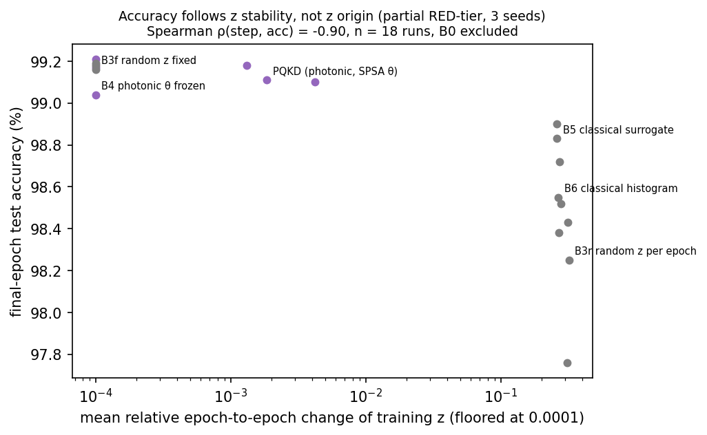

# Photonic Quantum-Enhanced Knowledge Distillation (PQKD) — Reproduction

**Status:**
- **Done:**
  - MNIST reproduction (Phase 3);
  - fair-baseline comparison (Phases 3 and 5);
  - MerLin adaptation at 4 photons (Phase 4).
- **Not run:** Fashion-MNIST/CIFAR-10, Table 2 / Fig. 2, the full Fig. 4 shot sweep, robustness.
- **Label:** partial RED-tier run (30 epochs, 3 seeds, CPU). Reproduction feasibility: `PARTIALLY_FEASIBLE`.

**Verdict:**
- The Table 1 trend is reproduced on MNIST.
- The paper's compactness and photonic-contribution claims are **unsupported** against fair baselines.
- Its shot-noise and EMA claims are **partially supported**, but are not specific to photonics.

## Reference and Attribution

- Paper: *Photonic Quantum-Enhanced Knowledge Distillation*, arXiv preprint, 2026.
- Authors: Kuan-Cheng Chen, Shang Yu, Chen-Yu Liu, Samuel Yen-Chi Chen, Huan-Hsin Tseng, Yen Jui Chang, Wei-Hao Huang, Felix Burt, Esperanza Cuenca Gomez, Zohim Chandani, William Clements, Ian Walmsley, Kin K. Leung.
- arXiv: https://arxiv.org/abs/2603.14898 (DOI 10.48550/arXiv.2603.14898).
- Original repository: none published ("available upon reasonable request").
- License: the paper is CC BY 4.0. Cite the arXiv record when reusing its figures, text or results. This reproduction is an independent implementation written from the paper text.

## Original Paper

PQKD compresses a CNN student during knowledge distillation (KD) from a larger teacher. Selected convolutions become **dictionary convolutions**:
- each layer learns only R spatial basis filters B;
- the channel-mixing tensor M is generated from a global conditioning vector, vec(M) = A z(θ), with A a fixed random matrix.

z(θ) ∈ R^512 comes from a programmable 16-mode, loop-based photonic interferometer with beam-splitter angles θ (dim θ ∈ {15, 30, 45}):
1. S threshold-detection shots are taken;
2. each 16-bit click pattern is split into two 8-bit halves;
3. the two 256-bin histograms are concatenated and standardised.

Training alternates SPSA updates of θ with Adam epochs on the student. The SPSA updates are gradient-free and driven by a validation KD objective. EMA smoothing of z across epochs (β = 0.9) is optional. The paper simulates the circuit with the ORCA simulator in CUDA-Q; no hardware runs are reported.

**Datasets:** MNIST, Fashion-MNIST, CIFAR-10 (45k/5k train/validation).

**Metrics:** validation accuracy and cross-entropy, a "photonic Δ" of the SPSA objective, and a test-accuracy gain δ relative to z = 0.

**Main claims:**
- **Table 1 / Fig. 3:** at 1.5× compression, PQKD matches the teacher on MNIST and Fashion-MNIST and lags it on CIFAR-10.
- **Table 2 / Fig. 2:** there is a smooth compression–accuracy frontier up to about 105×.
- **Fig. 4:** the photonic feature's gain follows δ(S) = δ∞ − k/√S, and EMA raises δ∞.
- **Supp. Note 5:** names KD-only, dictionary-only, random-feature and fixed-θ controls, but reports no numbers for them.

## Reproduction Scope, Claims, and Deviations

**Reproduced (MNIST, conv1 + conv2 compressed, R = 4, dim θ = 45):**

| Phase | What was run |
|---|---|
| 3 | Table 1 teacher and PQKD rows |
| 3 | Seven fair baselines B0–B6 at the same teacher, data and budget |
| 3 | Two predeclared SPSA grids |
| 4 | A MerLin adaptation (7 arms plus a 4-photon PQKD reference) |
| 5 | A fair comparison under a frozen protocol |

**Claims tested:**

| Claim | Outcome |
|---|---|
| C1 | trend reproduced; as an advantage, **unsupported** |
| C3, C9 | **unsupported** |
| C6, C7 | **partially supported**, not photonic-specific |
| C2, C4, C5, C8, C10 | unresolved (not run) |

**Deviations from the paper:**
- **Simulator:** MerLin replaces the CUDA-Q ORCA simulator.
  - The MerLin setup is `QuantumLayer` over the full Fock space, with threshold detection applied in post-processing.
  - Code uses only MerLin 0.4.2 public API calls. The runs used a pre-release MerLin build with the same API (`merlinquantum 0.5.0.dev0`).
- **Assumed settings (not reported in the paper):**
  - Phase 3 input: 8 photons in alternating modes, S = 200, EMA β = 0.9.
  - SPSA (a, c): set by predeclared grids, (0.01, 0.2) for photonic and (0.05, 0.2) for the classical surrogate.
  - θ_max = π.
- **Photon number in Phase 4:** 4 photons, [1,0,0,0]×4. 8 photons was too slow and memory-heavy for the CPU laptop. The paper does not state its photon number.
- **Standardisation:** μ and σ are fitted on features at random θ. At the paper's θ = 0 the circuit is a fixed permutation, so σ would be zero.
- **Parameter accounting:**
  - Each compressed layer has a bias and a per-output-channel gain, giving R·k² + 2·C_out trainable parameters.
  - This is the only accounting that reproduces the paper's compression factors.
- **Budget:** 30 epochs and 3 seeds, versus the paper's 100 epochs and 5 seeds. `*_original.json` configs keep the paper budget.
- **Metric:** final-epoch **test** accuracy is primary. The paper reports validation accuracy, and SPSA also tunes on the validation split.
- **θ regime (paper underspecification):** SPSA starts at θ = 0, and with the selected step sizes θ stays near it (‖θ‖ ≈ 1–2). z is then almost deterministic, so the paper's shot-noise claims are only exercised in the Phase 4 mixing-regime arms.

## Project Layout

```text
papers/photonic_QKD/
├── README.md, requirements.txt, cli.json, notebook.ipynb (executed walkthrough, about 4 min on CPU)
├── configs/   defaults.json + teacher / PQKD / baseline / Phase 4 / smoke configs
├── lib/       data.py, models.py (dictionary conv, CNNs), photonic.py (MerLin circuit + feature map),
│              conditioning.py (all z sources), training.py (KD, SPSA, checkpoints), runner.py
├── sweeps/    predeclared sweep specs S1–S6 and smoke specs
├── utils/     run_sweep.py / stop_sweep.py / launch_sweep.sh (coordinator), analyze_s4.py, analyze_s6.py,
│              compare_phase5.py, feature_stability.py, export_sweep_summary.py, plot_*.py
├── results/   curated tables (.md/.json) and figures referenced below
├── tests/     65 tests
└── models/    teacher_mnist_s1_seed0/teacher.pt (S1 seed-0 teacher, 0.9 MB; used by the notebook's live run); other weights stay in outdir/
```

`outdir/` holds raw runs and is git-ignored. `LOG.md`, `FEEDBACK.md` and `VISITED_URLS.md` are git-ignored working notes.

## Install and How to Run

```bash
pip install -r papers/photonic_QKD/requirements.txt
```

Each run trains one model. A student needs a finished teacher run on the same dataset, widths and split seed.

**Smoke** (seconds; code path only):

```bash
python implementation.py --paper photonic_QKD --config configs/smoke_teacher.json
python implementation.py --paper photonic_QKD --config configs/smoke_student.json --teacher-path papers/photonic_QKD/outdir/<teacher run>
```

**Reduced runs** (30 epochs, as reported here) and **paper-budget runs** (100 epochs):

```bash
python implementation.py --paper photonic_QKD --seed 0                                    # teacher, MNIST
python implementation.py --paper photonic_QKD --config configs/teacher_original.json --seed 0
python implementation.py --paper photonic_QKD --config configs/pqkd_merlin.json --teacher-path <teacher run dir> --seed 0
python implementation.py --paper photonic_QKD --config configs/pqkd_original.json --teacher-path <teacher run dir> --seed 0
python implementation.py --paper photonic_QKD --config configs/baseline_kd_dense_classical.json --teacher-path <teacher run dir> --seed 0
```

**Sweeps** (candidate × seed grids under one coordinator; student runs checkpoint every epoch):

```bash
python papers/photonic_QKD/utils/run_sweep.py papers/photonic_QKD/sweeps/S1_teacher_mnist_30ep.json
python papers/photonic_QKD/utils/run_sweep.py papers/photonic_QKD/sweeps/S4_mnist_pqkd_baselines.json
python papers/photonic_QKD/utils/run_sweep.py papers/photonic_QKD/sweeps/S6_mnist_photonic_regimes_4ph.json
python papers/photonic_QKD/utils/stop_sweep.py --latest                       # graceful stop, checkpoints kept
python papers/photonic_QKD/utils/run_sweep.py --resume <stopped sweep dir>    # completion sweep <id>_resumeN
```

S4 and S6 expect the S1 teacher sweep at the `teacher_sweep` path in their spec.

**Analyses** (read only structured artifacts; from the repo root):

```bash
python papers/photonic_QKD/utils/analyze_s4.py <S4 dir> <S4b dir> --teacher-sweep <S1 dir>
python papers/photonic_QKD/utils/analyze_s6.py <S6 dir> <resume1> <resume2> <resume3> --s4-sweeps <S4 dir> <S4b dir>
python papers/photonic_QKD/utils/compare_phase5.py --teacher-sweep <S1 dir> --s4-sweeps <S4> <S4b> --s6-sweeps <S6> <resume1> <resume2> <resume3>
```

The same run commands work from inside `papers/photonic_QKD` with `python ../../implementation.py --config configs/<name>.json ...`.

**Run output:** each run writes `outdir/run_YYYYMMDD-HHMMSS/`, and each sweep writes `outdir/sweeps/<id>_<timestamp>/`. A run folder contains:
- `run.log`, `run_status.json`, `config_snapshot.json`, `metrics.json`;
- `teacher.pt` or `student.pt`;
- `checkpoint.pt` (students);
- `feature_trace.npz` (raw and EMA z per epoch).

## Configuration

`configs/defaults.json` holds the paper hyperparameters:

| Setting | Value |
|---|---|
| Batch size | 64 |
| Optimiser | Adam 1e-3 |
| KD loss | τ = 3, λ = 0.5 |
| Dropout | 0.25 |
| SPSA | 10 steps per epoch |
| Feature size | d = 512 |
| Circuit | 16 modes |

It also holds the assumed values listed above. `cli.json` is the authoritative flag schema.

| Config | Purpose |
|---|---|
| `teacher_original.json` | teacher, 100 epochs |
| `pqkd_merlin.json` / `pqkd_original.json` | PQKD student, 30 / 100 epochs (8 photons) |
| `baseline_*_{classical,merlin}.json` | baselines B0–B6 |
| `pqkd_4ph_merlin.json` | Phase 4 P0: PQKD at 4 photons |
| `photonic_mixing_s{200,25}_{ema,noema}_4ph_merlin.json` | Phase 4 F1–F4 |
| `native_exact_grad_{random,zero}_4ph_merlin.json`, `native_surrogate_grad_4ph_classical.json` | Phase 4 N1–N3 |
| mixing / native configs without `4ph` | the same arms at 8 photons (GPU-scale; not run to completion) |
| `smoke_*.json` | tiny infrastructure runs |

Student configs contain `teacher.checkpoint: "<<RESULT_PATH>>"`. Pass `--teacher-path`; the runtime refuses to start until it is resolved.

**Main flags:**
- **Paper-specific:** `--task`, `--dataset {mnist,fashion_mnist,cifar10,synthetic}`, `--teacher-path`, `--conditioning`, `--student-variant`, `--shots`, `--ema`, `--theta-dim`, `--theta-init-mode`, `--spsa-a`, `--spsa-c`, `--epochs`, `--batch-size`, `--lr`, `--resume-from`.
- **Global**, from the shared runtime: `--seed`, `--device`, `--outdir`, `--data-root`, `--config`.

## Data

Datasets are the original torchvision MNIST, Fashion-MNIST and CIFAR-10 (canonical train and test). They are stored under `data/photonic_QKD/` (git-ignored) and download on first use through `torchvision.datasets.*(root=paper_data_dir("photonic_QKD"), download=True)`.
- **Verification:** archive MD5s match torchvision 0.25.0's pinned values, and split sizes are 60,000/10,000 (MNIST, Fashion-MNIST) and 50,000/10,000 (CIFAR-10).
- **Splits:** the paper's split indices are not published. The 45,000/5,000 train/validation split is a seeded permutation (`dataset.split_seed = 0`) of the canonical training set. The canonical test set is held out and used only for evaluation.
- **Preprocessing:**
  - MNIST and Fashion-MNIST: ToTensor, pixels in [0, 1], no normalisation or augmentation.
  - CIFAR-10: per-channel mean/std normalisation.
- **Synthetic data:** the paper's Gaussian-blob dataset (`--dataset synthetic`) is generated in memory and used only by tests.
- **Fallbacks:** none were needed.
- **Re-acquire everything** (from the repo root):

```bash
python -c "from runtime_lib.data_paths import paper_data_dir as p; import torchvision as tv; r=str(p('photonic_QKD')); [c(r, train=t, download=True) for c in (tv.datasets.MNIST, tv.datasets.FashionMNIST, tv.datasets.CIFAR10) for t in (True, False)]"
```

## Results Obtained and Comparison with the Paper

All local numbers are a **partial RED-tier run**: MNIST, 30 epochs, seeds 0–2, CPU. They are mean ± s.d. over seeds, final epoch unless noted.

| Label | Meaning |
|---|---|
| Metric agreement | the value is within the paper's reported s.d. |
| Trend agreement | the direction or qualitative behaviour matches |

| Paper item | Claim tested | Paper value (n=5, 100 ep) | Reproduced value (n=3, 30 ep) | Delta | Metric agreement | Trend agreement | Claim support | Seeds | Comment |
|---|---|---:|---:|---:|---|---|---|---:|---|
| Table 1 teacher val acc % | reference | 99.07 ± 0.13 | 99.03 ± 0.09 | −0.04 | yes | yes | — | 3 | final epoch |
| Table 1 teacher val CE | reference | 0.031 ± 0.002 | 0.034 ± 0.002 | +0.003 | near (1.5 paper s.d.) | yes | — | 3 | 0.0303 ± 0.0031 at the best-val checkpoint |
| Table 1 teacher train acc % | reference | 100.00 ± 0.00 | 99.61 ± 0.03 | −0.39 | no | yes | — | 3 | the paper's teacher saturates late; 30 vs 100 epochs |
| Table 1 PQKD val acc % | C1 | 99.09 ± 0.09 | 98.92 ± 0.16 | −0.17 | no (within the combined s.d.) | yes | trend reproduced | 3 | shorter budget |
| Table 1 PQKD val CE | C1 | 0.030 ± 0.001 | 0.034 ± 0.002 | +0.004 | no | yes | trend reproduced | 3 | shorter budget |
| Table 1 PQKD train acc % | C1 | 99.71 ± 0.02 | 99.23 ± 0.04 | −0.48 | no | yes | — | 3 | shorter budget |
| Table 1 compression C_x | C1 | 1.50 | 1.502 | +0.002 | yes | yes | — | — | needs the inferred gain + bias accounting |
| Table 1 photonic Δ (J first − final) | C3 | 5.94 ± 0.02 | 0.61 ± 0.10 | N/A | N/A (J's scale is undefined in the paper) | yes (Δ > 0) | **unsupported** as photonic evidence | 3 | B4 (θ frozen) gives the same accuracy |
| PQKD vs teacher, test acc | C1 | PQKD ≥ teacher (val) | 99.13 ± 0.04 vs 99.29 ± 0.01 | −0.16 | N/A (the paper reports val only) | yes ("close to the teacher") | trend reproduced; **unsupported** as an advantage | 3 | an iso-parameter dense KD student reaches 99.29 ± 0.08 |
| Fig. 4 δ (z vs z = 0), EMA on | C6 | δ∞ = 89.05 ± 5.61 | 87.78 ± 0.04 at S = 200 | −1.3 | yes (within the paper's s.d.) | yes | **unsupported** as photonic | 3 | a fixed random z gives 87.83; z = 0 zeroes every kernel |
| Fig. 4 shot dependence | C6 | δ(S) = δ∞ − k/√S | 25 shots, no EMA, vs P0: −3.93 ± 1.53 pp | N/A | N/A (2 S values, no fit) | yes (fewer shots cost accuracy) | **partially supported** | 3 | 4 photons, θ in a mixing regime |
| Fig. 4 EMA effect | C7 | EMA raises δ∞ (89 vs 47) | EMA at S = 25: +3.32 ± 1.15 pp | N/A | N/A | yes | **partially supported** | 3 | classical resampled z shows the same cost |
| Table 1 Fashion-MNIST / CIFAR-10 | C1 | see paper | not run | — | — | — | unresolved | — | CPU budget |
| Table 2 / Fig. 2 frontier | C4, C5 | see paper | not run | — | — | — | unresolved | — | about 10 h reduced; deferred |
| Supp. Fig. S1 EMA variance ratio | C8 | 0.0406 | not run | — | — | — | unresolved | — | F-arm feature traces would allow it |
| Noise robustness | C10 | no values | not run | — | — | — | unresolved | — | — |

The teacher test accuracy is taken at the best-validation checkpoint; students use the final epoch.

### Sweeps

Every sweep table below lists all candidates and is generated from structured metrics.

| Sweep | Purpose | Coverage | Selection (predeclared) | Result | Table |
|---|---|---|---|---|---|
| S1 | MNIST teachers, seeds 0–2 | COMPLETE SWEEP (3/3) | none (one candidate) | best-val checkpoint: val 99.18 ± 0.03, test 99.29 ± 0.01 | [`results/s1_teacher_mnist.md`](results/s1_teacher_mnist.md) |
| S2 | photonic SPSA (a, c) grid, seed 0, 10 ep | COMPLETE SWEEP (6/6) | min final val KD proxy, tie 0.002 → smaller a | selected a = 0.01, c = 0.2 (0.1425; next 0.1536) | [`results/s2_spsa_grid_photonic.md`](results/s2_spsa_grid_photonic.md) |
| S3 | classical surrogate SPSA grid (equal tuning budget) | COMPLETE SWEEP (6/6) | same rule | a = 0.05, c = 0.2 (0.1371) **tied** with a = 0.2, c = 0.05 (0.1378); tie-break selected a = 0.05, c = 0.2 | [`results/s3_spsa_grid_surrogate.md`](results/s3_spsa_grid_surrogate.md) |
| S4 + S4b | PQKD + B0–B6, seeds 0–2 | merged set 27/27 (see note) | none (comparison, no winner) | see Fair Baselines | [`results/s4_mnist_complete.md`](results/s4_mnist_complete.md) |
| S6 + resume1–3 | Phase 4 arms at 4 photons, seeds 0–2 | merged set 24/24 | none (comparison, no winner) | see Photonic Assessment | [`results/s6_mnist_4ph_complete.md`](results/s6_mnist_4ph_complete.md) |

- **Selection runs:** S2 and S3 are single-seed, 10-epoch runs used only to set the SPSA step sizes. They are not reproduction results.
- **Coordinator summaries:** each `summary.json` of the S4b and S6 resume coordinators "selects" a best arm within its own fragment of runs. Those per-fragment selections are not used. The merged tables above are authoritative, and they declare no winner.
- **S4 note:**
  - The S4 coordinator was killed by a WSL shutdown, so it is invalid at sweep level.
  - Its 17 runs are validated individually, and the completion sweep S4b (10 runs) is fully validated.
  - The 27-run set is therefore merged coverage, not a single COMPLETE SWEEP.
- **S6:** the original sweep and its resumes 1–2 are PARTIAL (user-requested stops); resume3 is COMPLETED. Every one of the 24 runs is validated.
- **S5:** the 8-photon version of S6 was stopped by the user after 1 run and is not used.

## Fair Baselines

The paper's comparators cannot test its claims (baseline state `MISSING_OR_UNFAIR`):
- the teacher is 1.5× larger;
- z = 0 is degenerate, because it zeroes every compressed kernel;
- the Supp. Note 5 controls report no numbers.

The fair baselines below were predeclared before any run. They share the teachers, data, seeds, epochs, optimiser and machine.


| Arm (8-photon PQKD and controls) | Matching | Test acc % | Δ vs PQKD (paired, pp) | Separated? |
|---|---|---|---|---|
| PQKD (photonic z, SPSA θ) | 149,439 params | 99.13 ± 0.04 | — | — |
| B1: dense KD student | 148,626 params (−0.5%) | 99.29 ± 0.08 | +0.16 ± 0.05 | yes, 3/3 |
| B2: learned mixing | +33k params (upper reference) | 99.26 ± 0.06 | +0.13 ± 0.02 | yes |
| B3f: fixed random z | same architecture | 99.18 ± 0.02 | +0.05 ± 0.04 | yes, 3/3 |
| B4: photonic z, θ frozen | same architecture | 99.14 ± 0.09 | +0.01 ± 0.09 | no |
| B5: classical 45-param generator, same SPSA grid | iso-parameter generator | 98.82 ± 0.09 | −0.31 ± 0.06 | yes |
| B6: classical click histograms, same Φ, S, EMA | same feature map | 98.48 ± 0.09 | −0.65 ± 0.08 | yes |
| B3r: random z redrawn every epoch | same architecture | 98.15 ± 0.35 | −0.98 ± 0.39 | yes |
| B0: z = 0 (paper's Fig. 4 control) | degenerate | 10.81 ± 0.93 | −88.3 ± 0.9 | not comparable |

"Separated" uses the predeclared rule: |mean paired Δ| > s.d. of the paired Δ.

**Accuracy follows the stability of z across epochs, not its source.** Spearman ρ = −0.90 over 18 runs ([`results/s4_feature_stability.md`](results/s4_feature_stability.md)).



**Phase 5 comparison** (protocol frozen before the table; full table with provenance, parameters, wall-clock and comparability status in [`results/phase5_comparison.md`](results/phase5_comparison.md)):


| Claim and axis | Decisive fair comparison (Δ test acc, pp) | Outcome |
|---|---|---|
| **A. Compactness** (C1) | dense KD at the same budget − PQKD: **+0.16 ± 0.05** (3/3). Exact-gradient photonic N1 − dense: −0.13 ± 0.09 | **UNSUPPORTED** as an advantage. "Close to the teacher" is trend-reproduced. |
| **B. Photonic contribution** (C9, C3, C6) | fixed random z − PQKD: **+0.05 ± 0.04** (3/3). θ frozen: +0.01 ± 0.09. N1 − N3 (photonic vs classical, both gradient-trained): +0.05 ± 0.10 | **UNSUPPORTED** |
| **C. Shot noise and EMA** (C6, C7) | 25 shots, no EMA − P0: **−3.93 ± 1.53**. EMA at 25 shots: **+3.32 ± 1.15**. Classical z redrawn − fixed: −1.03 ± 0.36 | **PARTIALLY_SUPPORTED**: direction only; a cost of noisy z, not a photonic benefit |

**Comparability:**
- **Partially commensurable:** the paper's values (validation metric, 100 epochs, n = 5), the teacher (best-val checkpoint, not iso-parameter) and B2.
- **Not commensurable:** B0.
- **Commensurable:** all other arms.

**Evidence labels:**
- **Advantage evidence:** N1/N2, against N3, B1 and B3f under the same conditions.
- **Characterization:** F1–F4. No classical baseline ran at S = 25 or without EMA.

**No quantum or photonic advantage is claimed.**

## Photonic Assessment and MerLin Extension

**Status: `MERLIN_IMPLEMENTATION`** (simulation; reduced-scope validation).

The paper is already photonic, so running it in MerLin (Phase 3) is a simulator substitution. Phase 4 adds two kinds of arms on the same circuit family:
- **F arms (paper-faithful, mixing regime):** θ starts at U[−π, π], so the sampler is genuinely stochastic. θ is trained by SPSA with S ∈ {200, 25}, EMA on or off.
- **N arms (MerLin-native, simulation only):**
  - z comes from MerLin's *exact* output distribution;
  - θ is an `nn.Parameter` trained by autograd jointly with the student on every batch;
  - N1 starts from random θ, N2 from θ = 0;
  - N3 is the classical counterpart, a 45-parameter cos(Gφ + b) generator trained the same way.
- **P0:** the paper-faithful PQKD at 4 photons, as the same-photon-number reference.

Sources:
- [`results/s6_mnist_4ph_complete.md`](results/s6_mnist_4ph_complete.md) (24/24 runs);
- `results/s6_mnist_4ph_test_accuracy.png`.


| Arm | Test acc % (trained z) | Test acc % (one fresh z) | Δ test vs P0 (paired, pp) |
|---|---|---|---|
| P0: PQKD, θ₀ = 0, S = 200, EMA | 99.19 ± 0.09 | 99.20 ± 0.08 | — |
| F1: mixing θ, S = 200, EMA | 98.78 ± 0.49 | 44.9 ± 47.1 | −0.41 ± 0.56 |
| F2: mixing θ, S = 200, no EMA | 97.80 ± 2.19 | 97.4 ± 3.0 | −1.40 ± 2.24 |
| F3: mixing θ, S = 25, EMA | 98.58 ± 0.63 | 12.5 ± 2.9 | −0.61 ± 0.54 (3/3 lower) |
| F4: mixing θ, S = 25, no EMA | 95.26 ± 1.60 | 47.9 ± 42.7 | −3.93 ± 1.53 (3/3 lower) |
| N1: exact z, autograd θ, θ₀ random | 99.15 ± 0.08 | 99.15 ± 0.08 | −0.04 ± 0.04 |
| N2: exact z, autograd θ, θ₀ = 0 | 99.15 ± 0.08 | 99.15 ± 0.08 | −0.04 ± 0.08 |
| N3: classical generator, autograd φ | 99.10 ± 0.02 | 99.10 ± 0.02 | −0.09 ± 0.11 |

Findings:
- **No photonic contribution, even with exact gradients.** N1 equals N3 (+0.05 ± 0.10) and a fixed random z (−0.02 ± 0.07). It is below the dense KD student (−0.13 ± 0.09).
- **Shot noise and EMA behave as the paper says, but only as costs.** No F arm beats P0, whose θ stays near the identity, where z is almost deterministic.
- **Students trained on smoothed or low-shot z depend on that exact z.** With one fresh unsmoothed draw:
  - F1 falls to chance on 2 of 3 seeds, F3 on 3 of 3, and F4 on 2 of 3.
  - Only F2 (200 shots, no EMA) stays robust, at 94–99% per seed.
- **θ = 0 is a stationary point of the exact gradient.** N2's angles never move (‖θ‖ = 0.00 on every seed).
- **Photon number does not matter for PQKD:** 4 vs 8 photons gives +0.06 ± 0.08.

## Hardware-Aware Settings

These settings apply to every Phase 4 (S6) arm.

| Field | Value |
|---|---|
| Computation space | `ComputationSpace.FOCK` (UNBUNCHED would discard bunched outcomes) |
| Detector model | ideal threshold detectors, applied in post-processing as clicks = 1[n > 0] |
| Photons / modes | 4 photons, 16 modes (3,876 Fock states) |
| Input state | [1,0,0,0]×4 |
| Encoding | none: data never enters the circuit; θ (45 beam-splitter angles, 3 tilings × 15) is the only circuit parameter |
| Measurement strategy | `MeasurementStrategy.probs(ComputationSpace.FOCK)`, then two 256-bin marginal click histograms (d = 512) |
| Postselection | none |
| Simulator or QPU | MerLin CPU simulator, float64, lossless and perfectly indistinguishable photons; **no hardware** |
| Shots | P0/F1/F2: 200 per feature evaluation; F3/F4: 25; N1/N2: exact; N3: no photonics |
| Gradients | P0/F: SPSA on samples (hardware-compatible); N1/N2: exact autograd (simulation only; hardware would need parameter-shift estimates) |
| Wall-clock | 1.5–1.8 h per 30-epoch run (3 runs in parallel × 4 CPU threads); native forward + backward 5.9 ms per batch (163–185 ms at 8 photons) |
| Seeds | 0, 1, 2 (same S1 teachers and split as Phase 3) |

The Phase 3 PQKD and photonic baselines used 8 photons ([1,0]×8, 490,314 Fock states) with the same detector model, measurement and simulator.

The Fock space grows as C(m + n − 1, n). The exact N arms are tractable only because this circuit is small; 8-photon native arms need a GPU.

## Limitations

- **Budget:** CPU only, MNIST only, 30 epochs and 3 seeds (paper: 100 epochs, 5 seeds). All results are partial RED-tier.
- **Unreported settings:** SPSA steps, shot budget, input photon pattern and the Fig. 4 configuration are absent from the paper. The values used are assumed or set by predeclared grids.
- **Simulation only:** no ORCA hardware. The MerLin runs used a pre-release build (`0.5.0.dev0`) with the 0.4.2 public API, and bitwise equality with PyPI 0.4.2 is not verified.
- **Phase 4 photon number:** 4 photons; the 8-photon arms need a GPU.
- **Not run:** Fashion-MNIST/CIFAR-10, Table 2 / Fig. 2, the full Fig. 4 shot sweep (only S ∈ {25, 200}), EMA variance ratio, robustness. Fashion-MNIST is the most informative next test of claim A, because there the paper reports PQKD 0.56 pp above the teacher.

## Tests

```bash
cd papers/photonic_QKD
python -m pytest -q
```

The 65 tests cover:
- the paper's parameter counts and compression factors;
- the dictionary kernel (Eqs. 6–7);
- photonic circuit ordering, threshold detection and the feature map;
- the KD loss and SPSA;
- every conditioning source, including gradient flow through the MerLin-native sources;
- per-epoch checkpoints: a stopped and resumed run reproduces an uninterrupted one exactly;
- sweep resume;
- end-to-end teacher → student runs on the synthetic dataset.

## Citation and License

Cite the original paper: K.-C. Chen, S. Yu, et al., *Photonic Quantum-Enhanced Knowledge Distillation*, arXiv:2603.14898 (2026). This reproduction's code follows the repository license.
