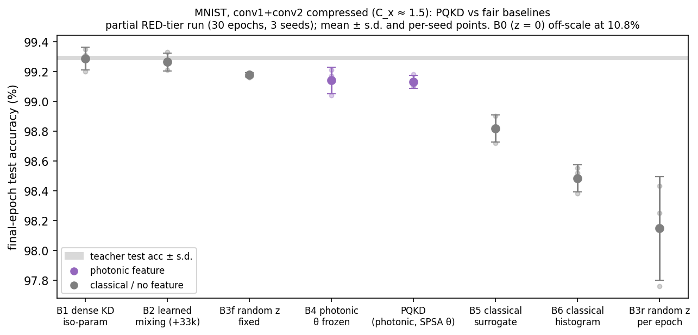
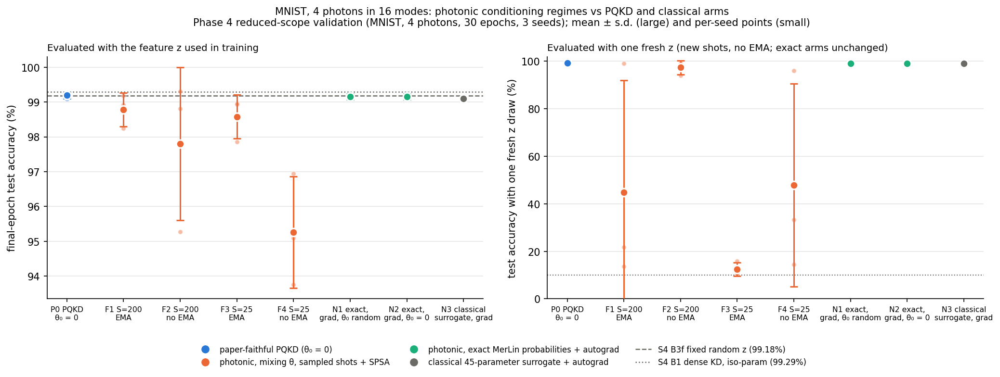
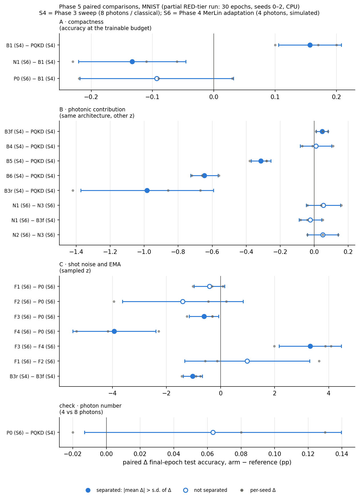

# Photonic Quantum-Enhanced Knowledge Distillation (PQKD) - Reproduction

Status: MNIST reproduction and fair-baseline comparison complete (Phase 3, partial RED-tier budget). The photonic contribution claimed by the paper is not supported. Feasibility `PARTIALLY_FEASIBLE` (CPU-only budget, unreported hyperparameters).

## Reference and Attribution

- Paper: Photonic Quantum-Enhanced Knowledge Distillation (arXiv preprint, 2026)
- Authors: Kuan-Cheng Chen, Shang Yu, Chen-Yu Liu, Samuel Yen-Chi Chen, Huan-Hsin Tseng, Yen Jui Chang, Wei-Hao Huang, Felix Burt, Esperanza Cuenca Gomez, Zohim Chandani, William Clements, Ian Walmsley, Kin K. Leung
- arXiv: https://arxiv.org/abs/2603.14898 (DOI 10.48550/arXiv.2603.14898)
- Original repository: none published ("available upon reasonable request")
- License: the paper is CC BY 4.0. Cite the arXiv record when reusing figures, text or results.

## Original Paper

PQKD compresses a CNN student during knowledge distillation from a larger teacher. Selected convolutions become **dictionary convolutions**:

- each layer learns only R spatial basis filters B;
- the channel-mixing tensor M is not learned; it is generated from a global conditioning vector, vec(M) = A z(θ), with a fixed random matrix A.

The vector z(θ) ∈ R^512 comes from a programmable 16-mode, loop-based photonic interferometer with beam-splitter angles θ (dim θ ∈ {15, 30, 45}):

- S threshold-detection shots are taken;
- each 16-bit click pattern is split into two 8-bit halves;
- the two 256-bin histograms are concatenated and standardised.

Training alternates SPSA updates of θ, which are gradient-free and driven by a validation KD objective, with Adam epochs on the student. EMA smoothing of z across epochs is optional.

Datasets: MNIST, Fashion-MNIST and CIFAR-10, each with a 45k/5k train/validation split.

Main claims:
- **Table 1:** at 1.5× compression, PQKD matches the teacher on MNIST and Fashion-MNIST and lags it on CIFAR-10.
- **Table 2 / Fig. 2:** there is a smooth compression–accuracy frontier up to about 105× overall compression.
- **Fig. 4:** the photonic feature's test-accuracy gain follows δ∞ − k/√S, and EMA raises δ∞.

## Reproduction Scope (including Updates and Deviations)

Evidence (details in the git-ignored `LOG.md`; results below):

- **Table 1 (MNIST first):** teacher (64,128,128) and PQKD (conv1+conv2 compressed, R=4, dim θ=45). Fashion-MNIST and CIFAR-10 follow.
- **Fair baselines** at the same teacher, data and budget. Selected with `student.variant` / `conditioning.source`:

  | ID | Baseline | What it is |
  |---|---|---|
  | B0 | `zero` | the paper's z = 0 control (degenerate: zero kernels) |
  | B1 | `dense` | dense KD-only student at the same trainable-parameter budget |
  | B2 | `dictionary_trainable` | M learned directly |
  | B3 | `random_fixed` / `random_resampled` | Gaussian z |
  | B4 | `photonic_fixed` | θ frozen |
  | B5 | `surrogate` | classical iso-parameter generator with the same SPSA |
  | B6 | `classical_histogram` | independent-mode clicks through the same Φ and S |

- **Phase 4 MerLin adaptation** at 4 photons: θ in a mixing regime with S ∈ {200, 25}, EMA on/off (Fig. 4 claims), and MerLin-native exact-gradient arms with a classical counterpart.
- Not yet: the full Fig. 4 shot sweep and the Table 2 operating points.

Updates and deviations:

- **Photonic simulation:** MerLin (`QuantumLayer`, full Fock space, threshold detection), in place of the CUDA-Q ORCA simulator used in the paper. Only MerLin 0.4.2 public API calls are used.
- **Assumed settings** (not reported in the paper): 8 photons in alternating input modes; S = 200; EMA β = 0.9 on; SPSA (a, c) = (0.05, 0.2) until a predeclared grid sets them.
- **Standardisation:** μ and σ are fitted on features at random θ. At the paper's initial θ = 0 the interferometer is the identity, so σ would be zero.
- **Parameter accounting:** each compressed layer has a bias **and a per-output-channel gain** (R·k² + 2·C_out trainable parameters). This is the only accounting that reproduces the paper's reported compression factors.
- **θ regime (paper underspecification, not a MerLin issue):** the paper starts SPSA at θ = 0. In any beam-splitter convention that is a fixed permutation, so every shot gives the same pattern. The SPSA step sizes that decide whether θ leaves this regime are not reported. MerLin's simulation of the near-identity circuit is correct (see `tests/test_photonic.py`).
- **Compute budget:** first runs are CPU-only with reduced budgets (30 epochs, 3 seeds; paper: 100 epochs, 5 seeds) and are labelled partial. `*_original.json` configs keep the paper budget.
- **Metrics:** test accuracy is the primary metric. The paper reports validation accuracy, which SPSA also tunes on.

## Install and How to Run

```bash
pip install -r papers/photonic_QKD/requirements.txt
```

Every run trains one model. Students need a finished teacher run on the same dataset, widths and split seed.

Smoke run (seconds; checks the code path only):

```bash
python implementation.py --paper photonic_QKD --config configs/smoke_teacher.json
python implementation.py --paper photonic_QKD --config configs/smoke_student.json --teacher-path papers/photonic_QKD/outdir/<teacher run>
```

Reduced runs (defaults: 30 epochs) and paper-budget runs (100 epochs):

```bash
python implementation.py --paper photonic_QKD --seed 0                                    # teacher, MNIST
python implementation.py --paper photonic_QKD --config configs/teacher_original.json --seed 0
python implementation.py --paper photonic_QKD --config configs/pqkd_merlin.json --teacher-path <teacher run dir> --seed 0
python implementation.py --paper photonic_QKD --config configs/pqkd_original.json --teacher-path <teacher run dir> --seed 0
python implementation.py --paper photonic_QKD --config configs/baseline_surrogate_classical.json --teacher-path <teacher run dir> --seed 0
```

Sweeps (seeded candidate × seed grids, one coordinator; each student run checkpoints every epoch):

```bash
python papers/photonic_QKD/utils/run_sweep.py papers/photonic_QKD/sweeps/S6_mnist_photonic_regimes_4ph.json
python papers/photonic_QKD/utils/stop_sweep.py --latest                       # graceful stop, checkpoints kept
python papers/photonic_QKD/utils/run_sweep.py --resume <stopped sweep dir>    # completion sweep <id>_resumeN
```

The same commands work from inside `papers/photonic_QKD` with `python ../../implementation.py --config configs/<name>.json ...`.

Each run writes `outdir/run_YYYYMMDD-HHMMSS/` with:
- `run.log`;
- `run_status.json`;
- `config_snapshot.json`;
- `metrics.json`;
- `teacher.pt` or `student.pt`;
- `feature_trace.npz` for conditioned students (raw and EMA z per epoch).

## Configuration

`configs/defaults.json` holds the paper hyperparameters: batch 64, Adam 1e-3, τ = 3, λ = 0.5, dropout 0.25, 10 SPSA steps per epoch, d = 512, 16 modes. It also holds the assumed values above.

| Config | Purpose |
|---|---|
| `teacher_original.json` | teacher, 100 epochs |
| `pqkd_merlin.json` / `pqkd_original.json` | PQKD student, 30 / 100 epochs |
| `baseline_*_{classical,merlin}.json` | baselines B0–B6 |
| `pqkd_4ph_merlin.json` | Phase 4 P0: PQKD at 4 photons |
| `photonic_mixing_s{200,25}_{ema,noema}_4ph_merlin.json` | Phase 4 F1–F4 |
| `native_exact_grad_{random,zero}_4ph_merlin.json`, `native_surrogate_grad_4ph_classical.json` | Phase 4 N1–N3 |
| `*_merlin.json` without `4ph` (mixing / native) | the same arms at 8 photons (GPU-scale; not run to completion) |
| `smoke_*.json` | tiny infrastructure runs |

Student configs contain `teacher.checkpoint: "<<RESULT_PATH>>"`. Pass `--teacher-path`; the runtime refuses to start until it is resolved.

Main flags (see `cli.json`): `--task`, `--dataset {mnist,fashion_mnist,cifar10,synthetic}`, `--teacher-path`, `--conditioning`, `--shots`, `--ema`, `--theta-dim`, `--spsa-a`, `--spsa-c`, `--epochs`, `--batch-size`, `--lr`. Global flags (`--seed`, `--device`, `--outdir`, `--data-root`, `--config`) come from the shared runtime.

## Data

The torchvision datasets live under `data/photonic_QKD/` and download on first use. The train/validation split is a seeded permutation (`dataset.split_seed = 0`) of the canonical training set; the canonical test set is held out. The paper's synthetic Gaussian-blob dataset (`--dataset synthetic`) is generated in memory.

## Results Obtained and Comparison with the Paper

All numbers come from a **partial RED-tier run**: MNIST only, 30 epochs (paper: 100), 3 seeds (paper: 5), CPU. They are mean ± s.d. over seeds, at the final epoch unless noted. Sources: `results/s4_mnist_complete.{md,json}` and `results/s4_feature_stability.{md,json}`, generated by `utils/analyze_s4.py` and `utils/feature_stability.py` from the validated sweeps S1 (teachers) and S2/S3 (SPSA grids), and from the baseline comparison S4 + S4b (27/27 runs). The S4 coordinator was killed by a WSL shutdown and cannot be validated at sweep level, so the comparison uses its 17 individually validated runs plus the 10 runs of the fully validated completion sweep S4b.

### Table 1 (MNIST, conv1+conv2 compressed, C_x = 1.50)

| Quantity | Paper (n=5, 100 ep) | Reproduced (n=3, 30 ep) |
|---|---|---|
| Teacher val acc % | 99.07 ± 0.13 | 99.03 ± 0.09 |
| Teacher val CE | 0.031 ± 0.002 | 0.034 ± 0.002 |
| PQKD val acc % | 99.09 ± 0.09 | 98.92 ± 0.16 |
| PQKD val CE | 0.030 ± 0.001 | 0.034 ± 0.002 |
| PQKD train acc % | 99.71 ± 0.02 | 99.23 ± 0.04 |
| Overall compression C_x | 1.50 | 1.502 |
| Photonic Δ | 5.94 ± 0.02 | 0.61 ± 0.10 (our J; the paper's quantity is undefined) |

The Table 1 trend is reproduced. PQKD stays within about 0.2 pp of the teacher at 1.5× compression; the remaining gaps are consistent with the shorter budget.

### Fair baselines (not reported in the paper)



| Arm (same teacher, data, budget) | Test acc % | Δ vs PQKD (paired, pp) |
|---|---|---|
| PQKD (photonic z, SPSA θ) | 99.13 ± 0.04 | — |
| B4: photonic z, θ frozen | 99.14 ± 0.09 | +0.01 ± 0.09 |
| B3f: fixed random Gaussian z | 99.18 ± 0.02 | +0.05 ± 0.04 |
| B1: dense KD student, same trainable budget | 99.29 ± 0.08 | +0.16 ± 0.05 |
| B2: learned mixing (+33k params) | 99.26 ± 0.06 | +0.13 ± 0.02 |
| B5: classical iso-parameter generator, SPSA | 98.82 ± 0.09 | −0.31 ± 0.06 |
| B6: classical click histograms, same Φ and S | 98.48 ± 0.09 | −0.65 ± 0.08 |
| B3r: Gaussian z redrawn every epoch | 98.15 ± 0.35 | −0.98 ± 0.39 |
| B0: z = 0 (the paper's Fig. 4 control) | 10.81 ± 0.93 | −88.3 ± 0.9 |

Findings:
- **No photonic contribution is observed.**
  - Freezing θ, or replacing the photonic feature with a fixed random vector, leaves accuracy unchanged.
  - A dense KD student with the same number of trainable parameters is better on every seed.
- **The paper's "photonic gain" (Fig. 4) does not isolate the photonic module.** z = 0 sets every compressed kernel to zero (chance accuracy), so any working z, photonic or random, shows a gain of about 88 pp, close to the paper's fitted δ∞ = 89.
- **Accuracy follows how stable z is across epochs, not where it comes from** (Spearman ρ = −0.90 over 18 runs; see `results/s4_feature_stability.png`).
- **In these runs the photonic z is almost constant.** The paper's initial θ = 0 makes every beam splitter the identity, and the SPSA step chosen by our predeclared grid moves θ only slightly. So shot noise is practically absent here. The paper's shot-noise and EMA claims (Fig. 4) need θ in a mixing regime and are being tested separately.

### Phase 4: MerLin adaptation at 4 photons (simulation first)

Photonic translation status: **`MERLIN_IMPLEMENTATION`**. The paper is already photonic, so swapping the backend to MerLin (above) is only a simulator substitution. Phase 4 asks two further questions on the same circuit family:
- **F arms (paper-faithful, mixing regime):** θ starts at U[−π, π], so the sampler is genuinely stochastic. θ is trained by SPSA with shots S ∈ {200, 25), with and without EMA. This exercises the paper's shot-noise and EMA claims (Fig. 4), which the θ = 0 regime cannot.
- **N arms (MerLin-native):** z comes from MerLin's *exact* output distribution, and θ is an `nn.Parameter` trained by autograd jointly with the student on every batch. This is not possible on hardware.
  - N1 starts from random θ and N2 from θ = 0.
  - N3 is the classical counterpart: a 45-parameter cos(Gφ + b) generator trained the same way.

All arms run at **4 photons** ([1,0,0,0]×4 in 16 modes, 3,876 Fock states). 8 photons (490,314 states) was too slow and memory-heavy for the CPU laptop, a user decision recorded in `LOG.md`. The paper does not state its photon number. P0 is the paper-faithful PQKD rerun at 4 photons, as the same-photon-number reference.

Source: `results/s6_mnist_4ph_complete.{md,json}` and `results/s6_mnist_4ph_test_accuracy.png`, from `utils/analyze_s6.py` / `utils/plot_s6.py`. They merge the validated sweep `S6_mnist_photonic_regimes_4ph` with its resume sweeps 1–3 (user-requested stop/resume from per-epoch checkpoints); 24/24 runs. Reduced-scope validation: MNIST, 30 epochs, 3 seeds.



| Arm | Test acc % (trained z) | Test acc % (one fresh z) | Δ test vs P0 (paired, pp) |
|---|---|---|---|
| P0: PQKD, θ₀ = 0, S = 200, EMA | 99.19 ± 0.09 | 99.20 ± 0.08 | — |
| F1: mixing θ, S = 200, EMA | 98.78 ± 0.49 | 44.9 ± 47.1 | −0.41 ± 0.56 |
| F2: mixing θ, S = 200, no EMA | 97.80 ± 2.19 | 97.4 ± 3.0 | −1.40 ± 2.24 |
| F3: mixing θ, S = 25, EMA | 98.58 ± 0.63 | 12.5 ± 2.9 | −0.61 ± 0.54 (3/3 seeds lower) |
| F4: mixing θ, S = 25, no EMA | 95.26 ± 1.60 | 47.9 ± 42.7 | −3.93 ± 1.53 (3/3 seeds lower) |
| N1: exact z, autograd θ, θ₀ random | 99.15 ± 0.08 | 99.15 ± 0.08 | −0.04 ± 0.04 |
| N2: exact z, autograd θ, θ₀ = 0 | 99.15 ± 0.08 | 99.15 ± 0.08 | −0.04 ± 0.08 |
| N3: classical surrogate, autograd φ | 99.10 ± 0.02 | 99.10 ± 0.02 | −0.09 ± 0.11 |

Key paired comparisons (predeclared rule: an arm differs only if |mean paired Δ| > its s.d. over seeds):

| Comparison | Δ test acc (pp) | Differs? |
|---|---|---|
| N1 − N3 (photonic vs classical, both gradient-trained, 45 params) | +0.05 ± 0.10 | no |
| N1 − S4 B3f (fixed random z) | −0.02 ± 0.07 | no |
| N1 − S4 B1 (dense KD, same trainable budget) | −0.13 ± 0.09 | yes, lower on 3/3 seeds |
| P0 − S4 PQKD at 8 photons | +0.06 ± 0.08 | no |
| F3 − F4 (EMA at S = 25) | +3.32 ± 1.15 | yes, higher on 3/3 seeds |
| F1 − F2 (EMA at S = 200) | +0.98 ± 2.31 | no |

Findings:
- **The photonic module still adds nothing measurable** (claim C9). Even with exact probabilities and true gradients, the photonic z matches a classical 45-parameter generator and a fixed random vector. It stays below the dense KD student.
- **Shot noise and EMA behave as the paper says, but only as costs.** In the mixing regime, fewer shots lower accuracy, and EMA recovers most of the loss at S = 25. No F arm beats P0, which never leaves the near-identity regime where z is almost deterministic.
- **EMA-trained students depend on their exact smoothed z.** With one fresh unsmoothed draw, F1 and F3 drop to chance on most seeds (F3 on all 3). The trained model cannot be deployed on new hardware samples without the same smoothing history.
- **θ = 0 is a stationary point of the exact gradient:** N2's angles stay exactly at 0 (‖θ‖ = 0.00 on every seed). The paper's initialisation therefore never moves under gradient training either.
- **Changing from 8 to 4 photons changes nothing for PQKD** (P0 vs S4 PQKD).

Hardware-aware reporting (every S6 arm):

| Field | Value |
|---|---|
| Computation space | `ComputationSpace.FOCK` (full Fock space; UNBUNCHED would post-select away bunched outcomes) |
| Detector model | ideal threshold detectors, applied in post-processing as clicks = 1[n > 0] |
| Photon number / modes | 4 photons, 16 modes |
| Input state | [1,0,0,0]×4 (one photon every 4 modes, 2 per 8-mode half) |
| Encoding | none: data never enters the circuit; θ (45 beam-splitter angles, 3 tilings × 15) is the only circuit parameter |
| Measurement strategy | `MeasurementStrategy.probs(ComputationSpace.FOCK)`, then two 256-bin marginal click histograms (d = 512) |
| Postselection | none |
| Simulator or QPU | MerLin CPU simulator, float64, lossless and perfectly indistinguishable photons; **no hardware** |
| Shots | P0/F1/F2: 200 per feature evaluation; F3/F4: 25; N1/N2: exact (no sampling); N3: no photonics |
| Gradients | P0/F: SPSA on sampled outcomes (hardware-compatible); N1/N2: exact autograd through MerLin probabilities (simulation-only; hardware would need parameter-shift estimates) |
| Wall-clock | 1.5–1.8 h per 30-epoch run (3 runs in parallel × 4 CPU threads, laptop); native feature forward + backward 5.9 ms per batch at 4 photons (163–185 ms at 8 photons) |
| Seeds | 0, 1, 2 (same S1 teachers and data split as Phase 3) |

Scaling: the Fock space grows as C(m + n − 1, n), so the exact N arms are tractable here only because the circuit is small. 8 photons needs a GPU.

### Phase 5: fair comparison and claim outcomes

**Baseline state: `MISSING_OR_UNFAIR`.** None of the paper's comparators can test its claims:
- **Compactness:** the teacher has 1.5× the parameters, so it is not an iso-parameter comparator.
- **Photonic contribution and shot noise:** z = 0 is degenerate, because it zeroes every compressed kernel. The supplementary controls are named but report no numbers.

So the comparison uses the fair baselines B1–B6 predeclared before any run (S4/S4b) and the Phase 4 MerLin arms (S6). All share the S1 teachers, seeds 0–2, splits, 30 epochs and the same laptop (3 runs in parallel × 4 threads).

The protocol was frozen in `LOG.md` before this table was generated: final-epoch test accuracy, paired per seed, and "separated" only if |mean Δ| > s.d. of Δ. No new runs were needed.

Sources:
- `results/phase5_comparison.{md,json}` (full table: provenance, scope, run counts, parameters, wall-clock, comparison status);
- `results/phase5_paired_differences.png`;
- both generated by `utils/compare_phase5.py` / `utils/plot_phase5.py`.



| Claim and axis | Decisive fair comparison (Δ test acc, pp) | Outcome |
|---|---|---|
| **A. Compactness** (C1): PQKD matches the teacher at C_x ≈ 1.5 | Dense KD student at the same trainable budget − PQKD: **+0.16 ± 0.05** (3/3 seeds). Exact-gradient photonic N1 − dense: −0.13 ± 0.09 | **UNSUPPORTED** as an advantage. "PQKD stays close to the teacher" is trend-reproduced, but a plain dense student of the same size does better. |
| **B. Photonic contribution** (C9, C3, C6) | Fixed random z − PQKD: **+0.05 ± 0.04** (3/3). θ frozen − PQKD: +0.01 ± 0.09. Exact-gradient photonic − classical generator (N1 − N3): +0.05 ± 0.10 | **UNSUPPORTED.** No photonic contribution is separable from a fixed random conditioning vector. Classical arms that are worse than PQKD (B5, B6, B3r) all feed the student a z that changes during training. |
| **C. Shot noise and EMA** (C6, C7) | 25 shots, no EMA − P0: **−3.93 ± 1.53**. EMA at 25 shots: **+3.32 ± 1.15** (3/3). Classical z redrawn every epoch − fixed: −1.03 ± 0.36 | **PARTIALLY_SUPPORTED** (direction only, two shot values, no δ(S) fit). The effects are costs of a noisy z, shared by classical resampled z, not a photonic benefit. |

Comparison statuses:
- **PARTIALLY_COMMENSURABLE:** the paper's values (validation metric, 100 epochs, n = 5), the teacher (best-val checkpoint, not iso-parameter) and B2 (+33k parameters).
- **INCOMPARABLE:** B0 (degenerate).
- **COMMENSURABLE:** everything else.

The MerLin arms are a simulated adaptation, not hardware evidence. No quantum or photonic advantage is claimed.

Not yet run: Fashion-MNIST/CIFAR-10 (Table 1), Table 2 / Fig. 2 compression scaling, the full Fig. 4 shot sweep and the robustness study. Fashion-MNIST, where the paper reports PQKD 0.56 pp above the teacher, is the most informative next test of claim A.

## Limitations

- **CPU-only:** reduced epochs and seeds until a GPU machine is available.
- **Unreported settings:** SPSA step sizes, shot budget, input photon pattern and the Fig. 4 configuration are not in the paper; the assumed values are listed above.
- **Simulation only:** no ORCA hardware was used. The N arms' exact gradients are not available on hardware.
- **Phase 4 at 4 photons:** chosen for CPU memory and time. The paper's photon number is not stated; 8-photon configs exist but need a GPU.

## Tests

```bash
cd papers/photonic_QKD
python -m pytest -q
```

The 65 tests cover:
- the paper's parameter counts and compression factors;
- the dictionary kernel (Eqs. 6–7);
- photonic circuit ordering and threshold detection, and the feature map;
- the KD loss and SPSA;
- every conditioning source, including gradient flow through the MerLin-native sources;
- per-epoch checkpoints: a stopped and resumed run reproduces an uninterrupted one exactly;
- sweep resume;
- end-to-end teacher → student runs on the synthetic dataset.

## Citation and License

Cite arXiv:2603.14898. This reproduction's code follows the repository license.
